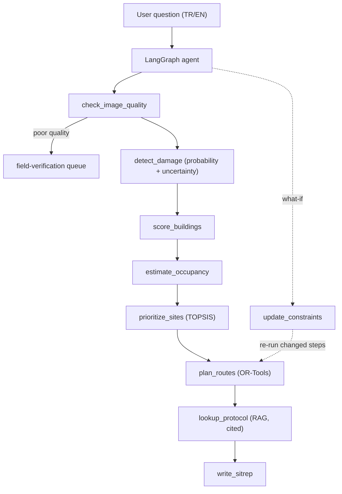

# QuakeTriage

**Agentic post-earthquake building damage assessment and rescue prioritization.**

> ⚠️ Research prototype only. Not validated for operational use in real search-and-rescue operations.

## Overview

QuakeTriage answers the question:
> "The damage map is ready. Where should I send my limited rescue teams first, and by which route? Which buildings is the model uncertain about?"

Given pre/post-earthquake satellite imagery, QuakeTriage:
1. Detects damaged buildings (change detection model with uncertainty)
2. Scores buildings by estimated occupancy and damage severity
3. Prioritizes sites using TOPSIS multi-criteria decision analysis
4. Plans optimal team routes with OR-Tools (prize-collecting VRP)
5. Grounds decisions in AFAD TAMP and INSARAG guidelines via RAG
6. Presents results through an interactive Gradio interface

## Architecture



Planned design; components are added week by week (see `PLAN.md`).

## Status

Work in progress — 8-week development plan (Nov–Dec 2026).

## Planning comparison (SIMULATED detector)

Antakya demo set, 400 candidate buildings, 4 teams, 6 h, 30 min per building, closed roads with a walking leg
(`reports/metrics_planning.json`; damage probabilities come from a simulated detector, the depot is a scenario
assumption):

| Method | Priority collected | Persons reached | Visits |
|---|---|---|---|
| OR-Tools prize-collecting VRP | 27.80 | 3,969 | 44 |
| Highest priority first | 23.29 | 3,273 | 36 |
| Nearest first (greedy) | 18.54 | 1,453 | 44 |
| Random (30 seeds, mean) | 15.43 | 1,455 | 35.9 |

The VRP collects **19 % more priority than the highest-priority-first rule**, 1.5x the nearest-first rule and
1.8x the random rule. These numbers describe planning behaviour on simulated detections, not rescue outcomes.

## Results

Generated from `reports/*.json` by `make report`; do not edit by hand.

<!-- results:begin -->
| Report | Metric | Value |
|---|---|---|
| `agent_eval` | `metrics.task_success.passed` | 30 |
| `agent_eval` | `metrics.task_success.total` | 38 |
| `agent_eval` | `metrics.task_success.rate` | 0.789 |
| `agent_eval` | `metrics.tool_selection_exact.passed` | 45 |
| `agent_eval` | `metrics.tool_selection_exact.total` | 48 |
| `agent_eval` | `metrics.tool_selection_exact.rate` | 0.938 |
| `agent_eval` | `metrics.forbidden_behaviour.total_violations` | 0 |
| `agent_eval` | `metrics.citation.cited_gold_page.passed` | 3 |
| `agent_eval` | `metrics.citation.cited_gold_page.total` | 8 |
| `agent_eval` | `metrics.citation.cited_gold_page.rate` | 0.375 |
| `agent_eval` | `metrics.citation.dangling_citations` | 0 |
| `agent_eval` | `metrics.citation.rough_support_sentences.passed` | 12 |
| `agent_eval` | `metrics.citation.rough_support_sentences.total` | 18 |
| `agent_eval` | `metrics.citation.rough_support_sentences.rate` | 0.667 |
| `agent_eval` | `metrics.citation.hand_reviewed.passed` | 4 |
| `agent_eval` | `metrics.citation.hand_reviewed.total` | 8 |
| `agent_eval` | `metrics.citation.hand_reviewed.rate` | 0.5 |
| `agent_eval` | `metrics.citation.hand_reviewed.wrong_answers` | 1 |
| `agent_eval` | `metrics.citation.hand_reviewed.honest_no_answer_but_info_exists` | 3 |
| `agent_eval` | `metrics.citation.hand_reviewed.scope` | 5 strict failures read by hand; the 3 strict passes were not re-read |
| `agent_eval` | `metrics.citation.hand_reviewed.details.P03.verdict` | miss_honest |
| `agent_eval` | `metrics.citation.hand_reviewed.details.P03.acceptable` | False |
| `agent_eval` | `metrics.citation.hand_reviewed.details.P03.note` | Router query 'USAR sector division guidelines' returned pages 56/7, not the gold p.25 that holds 5.5.1 'Why to create sectors'. Answer says the passages do not contain it: honest, but unhelpful. Question run with the original text retrieves p.25. |
| `agent_eval` | `metrics.citation.hand_reviewed.details.P04.verdict` | acceptable_alternative_source |
| `agent_eval` | `metrics.citation.hand_reviewed.details.P04.acceptable` | True |
| `agent_eval` | `metrics.citation.hand_reviewed.details.P04.note` | Cites INSARAG Vol2 ManB p.20 instead of the gold Vol3 p.19. The cited passage lists the search-team tasks (assess the collapsed structure, interview the public, risk analysis) and the answer is supported by it. Gold page kept; counted acceptable only in the hand-reviewed number. |
| `agent_eval` | `metrics.citation.hand_reviewed.details.P06.verdict` | wrong_answer |
| `agent_eval` | `metrics.citation.hand_reviewed.details.P06.acceptable` | False |
| `agent_eval` | `metrics.citation.hand_reviewed.details.P06.note` | Answer 'afet oncesi, afet sirasi, afet sonrasi' is not in the cited p.3 chunk; gold p.18 says the three phases are hazirlik, mudahale, on iyilestirme. An unsupported (wrong) claim that the rough keyword support check did not catch. Earlier note in decisions.md that this answer 'looks correct' was wrong. |
| `agent_eval` | `metrics.citation.hand_reviewed.details.P07.verdict` | miss_honest |
| `agent_eval` | `metrics.citation.hand_reviewed.details.P07.acceptable` | False |
| `agent_eval` | `metrics.citation.hand_reviewed.details.P07.note` | Router query 'AFAD TAMP operation service subservices' missed gold p.25 (2.5.1 Operasyon Servisi); answer says the passages contain no information although the corpus does. |
| `agent_eval` | `metrics.citation.hand_reviewed.details.P08.verdict` | miss_honest |
| `agent_eval` | `metrics.citation.hand_reviewed.details.P08.acceptable` | False |
| `agent_eval` | `metrics.citation.hand_reviewed.details.P08.note` | Router query 'AFAD establishment law Turkey' missed the preface (p.1-3: '5902 sayili Kanun gereği AFAD'in kurulmasi'); answer says no information, although the corpus has it. |
| `agent_eval` | `metrics.latency_s_per_turn.mean` | 29.78 |
| `agent_eval` | `metrics.latency_s_per_turn.p50` | 32.91 |
| `agent_eval` | `metrics.latency_s_per_turn.p95` | 48.52 |
| `agent_eval` | `metrics.latency_s_per_turn.max` | 49.66 |
| `agent_eval` | `metrics.llm.calls_total` | 236 |
| `agent_eval` | `metrics.llm.answers_by_provider.gemini` | 8 |
| `agent_eval` | `metrics.llm.answers_by_provider.groq` | 44 |
| `agent_eval` | `metrics.llm.successful_answers` | 52 |
| `comparison_siamese_vs_baseline_f1` | `threshold_mode` | f1 |
| `comparison_siamese_vs_baseline_f1` | `selected_on` | validation |
| `comparison_siamese_vs_baseline_f1` | `evaluated_on` | test |
| `comparison_siamese_vs_baseline_f1` | `n_test` | 38 |
| `comparison_siamese_vs_baseline_f1` | `models.early_fusion.threshold` | 0.2 |
| `comparison_siamese_vs_baseline_f1` | `models.early_fusion.metrics.precision` | 0.6354 |
| `comparison_siamese_vs_baseline_f1` | `models.early_fusion.metrics.recall` | 0.4145 |
| `comparison_siamese_vs_baseline_f1` | `models.early_fusion.metrics.f1` | 0.5017 |
| `comparison_siamese_vs_baseline_f1` | `models.early_fusion.metrics.iou` | 0.3348 |
| `comparison_siamese_vs_baseline_f1` | `models.siamese.threshold` | 0.2 |
| `comparison_siamese_vs_baseline_f1` | `models.siamese.metrics.precision` | 0.7319 |
| `comparison_siamese_vs_baseline_f1` | `models.siamese.metrics.recall` | 0.5108 |
| `comparison_siamese_vs_baseline_f1` | `models.siamese.metrics.f1` | 0.6017 |
| `comparison_siamese_vs_baseline_f1` | `models.siamese.metrics.iou` | 0.4303 |
| `comparison_siamese_vs_baseline_f1` | `paired_bootstrap_siamese_minus_baseline.f1.metric` | f1 |
| `comparison_siamese_vs_baseline_f1` | `paired_bootstrap_siamese_minus_baseline.f1.mean_diff` | 0.1038 |
| `comparison_siamese_vs_baseline_f1` | `paired_bootstrap_siamese_minus_baseline.f1.ci95_lo` | 0.03829 |
| `comparison_siamese_vs_baseline_f1` | `paired_bootstrap_siamese_minus_baseline.f1.ci95_hi` | 0.1657 |
| `comparison_siamese_vs_baseline_f1` | `paired_bootstrap_siamese_minus_baseline.f1.p_not_better` | 0 |
| `comparison_siamese_vs_baseline_f1` | `paired_bootstrap_siamese_minus_baseline.iou.metric` | iou |
| `comparison_siamese_vs_baseline_f1` | `paired_bootstrap_siamese_minus_baseline.iou.mean_diff` | 0.09857 |
| `comparison_siamese_vs_baseline_f1` | `paired_bootstrap_siamese_minus_baseline.iou.ci95_lo` | 0.03736 |
| `comparison_siamese_vs_baseline_f1` | `paired_bootstrap_siamese_minus_baseline.iou.ci95_hi` | 0.155 |
| `comparison_siamese_vs_baseline_f1` | `paired_bootstrap_siamese_minus_baseline.iou.p_not_better` | 0 |
| `comparison_siamese_vs_baseline_f1` | `paired_bootstrap_siamese_minus_baseline.precision.metric` | precision |
| `comparison_siamese_vs_baseline_f1` | `paired_bootstrap_siamese_minus_baseline.precision.mean_diff` | 0.09649 |
| `comparison_siamese_vs_baseline_f1` | `paired_bootstrap_siamese_minus_baseline.precision.ci95_lo` | -0.003213 |
| `comparison_siamese_vs_baseline_f1` | `paired_bootstrap_siamese_minus_baseline.precision.ci95_hi` | 0.1961 |
| `comparison_siamese_vs_baseline_f1` | `paired_bootstrap_siamese_minus_baseline.precision.p_not_better` | 0.03 |
| `comparison_siamese_vs_baseline_f1` | `paired_bootstrap_siamese_minus_baseline.recall.metric` | recall |
| `comparison_siamese_vs_baseline_f1` | `paired_bootstrap_siamese_minus_baseline.recall.mean_diff` | 0.09901 |
| `comparison_siamese_vs_baseline_f1` | `paired_bootstrap_siamese_minus_baseline.recall.ci95_lo` | 0.01546 |
| `comparison_siamese_vs_baseline_f1` | `paired_bootstrap_siamese_minus_baseline.recall.ci95_hi` | 0.1749 |
| `comparison_siamese_vs_baseline_f1` | `paired_bootstrap_siamese_minus_baseline.recall.p_not_better` | 0.011 |
| `comparison_siamese_vs_baseline_f2` | `threshold_mode` | f2 |
| `comparison_siamese_vs_baseline_f2` | `selected_on` | validation |
| `comparison_siamese_vs_baseline_f2` | `evaluated_on` | test |
| `comparison_siamese_vs_baseline_f2` | `n_test` | 38 |
| `comparison_siamese_vs_baseline_f2` | `models.early_fusion.threshold` | 0.01 |
| `comparison_siamese_vs_baseline_f2` | `models.early_fusion.metrics.precision` | 0.5238 |
| `comparison_siamese_vs_baseline_f2` | `models.early_fusion.metrics.recall` | 0.5072 |
| `comparison_siamese_vs_baseline_f2` | `models.early_fusion.metrics.f1` | 0.5154 |
| `comparison_siamese_vs_baseline_f2` | `models.early_fusion.metrics.iou` | 0.3472 |
| `comparison_siamese_vs_baseline_f2` | `models.siamese.threshold` | 0.02 |
| `comparison_siamese_vs_baseline_f2` | `models.siamese.metrics.precision` | 0.5983 |
| `comparison_siamese_vs_baseline_f2` | `models.siamese.metrics.recall` | 0.5881 |
| `comparison_siamese_vs_baseline_f2` | `models.siamese.metrics.f1` | 0.5932 |
| `comparison_siamese_vs_baseline_f2` | `models.siamese.metrics.iou` | 0.4217 |
| `comparison_siamese_vs_baseline_f2` | `paired_bootstrap_siamese_minus_baseline.f1.metric` | f1 |
| `comparison_siamese_vs_baseline_f2` | `paired_bootstrap_siamese_minus_baseline.f1.mean_diff` | 0.08053 |
| `comparison_siamese_vs_baseline_f2` | `paired_bootstrap_siamese_minus_baseline.f1.ci95_lo` | 0.03199 |
| `comparison_siamese_vs_baseline_f2` | `paired_bootstrap_siamese_minus_baseline.f1.ci95_hi` | 0.1351 |
| `comparison_siamese_vs_baseline_f2` | `paired_bootstrap_siamese_minus_baseline.f1.p_not_better` | 0 |
| `comparison_siamese_vs_baseline_f2` | `paired_bootstrap_siamese_minus_baseline.iou.metric` | iou |
| `comparison_siamese_vs_baseline_f2` | `paired_bootstrap_siamese_minus_baseline.iou.mean_diff` | 0.07666 |
| `comparison_siamese_vs_baseline_f2` | `paired_bootstrap_siamese_minus_baseline.iou.ci95_lo` | 0.03157 |
| `comparison_siamese_vs_baseline_f2` | `paired_bootstrap_siamese_minus_baseline.iou.ci95_hi` | 0.1238 |
| `comparison_siamese_vs_baseline_f2` | `paired_bootstrap_siamese_minus_baseline.iou.p_not_better` | 0 |
| `comparison_siamese_vs_baseline_f2` | `paired_bootstrap_siamese_minus_baseline.precision.metric` | precision |
| `comparison_siamese_vs_baseline_f2` | `paired_bootstrap_siamese_minus_baseline.precision.mean_diff` | 0.07431 |
| `comparison_siamese_vs_baseline_f2` | `paired_bootstrap_siamese_minus_baseline.precision.ci95_lo` | -0.005027 |
| `comparison_siamese_vs_baseline_f2` | `paired_bootstrap_siamese_minus_baseline.precision.ci95_hi` | 0.1536 |
| `comparison_siamese_vs_baseline_f2` | `paired_bootstrap_siamese_minus_baseline.precision.p_not_better` | 0.039 |
| `comparison_siamese_vs_baseline_f2` | `paired_bootstrap_siamese_minus_baseline.recall.metric` | recall |
| `comparison_siamese_vs_baseline_f2` | `paired_bootstrap_siamese_minus_baseline.recall.mean_diff` | 0.08349 |
| `comparison_siamese_vs_baseline_f2` | `paired_bootstrap_siamese_minus_baseline.recall.ci95_lo` | 0.006421 |
| `comparison_siamese_vs_baseline_f2` | `paired_bootstrap_siamese_minus_baseline.recall.ci95_hi` | 0.1628 |
| `comparison_siamese_vs_baseline_f2` | `paired_bootstrap_siamese_minus_baseline.recall.p_not_better` | 0.016 |
| `depot_sensitivity` | `n_buildings` | 5895 |
| `depot_sensitivity` | `alternatives.hospital (OSM way 366665647).spearman` | 0.7239 |
| `depot_sensitivity` | `alternatives.hospital (OSM way 366665647).top100_overlap` | 0.99 |
| `depot_sensitivity` | `alternatives.hospital (OSM way 366665647).top500_overlap` | 0.984 |
| `depot_sensitivity` | `alternatives.town hall (OSM way 311391399).spearman` | 0.8414 |
| `depot_sensitivity` | `alternatives.town hall (OSM way 311391399).top100_overlap` | 0.99 |
| `depot_sensitivity` | `alternatives.town hall (OSM way 311391399).top500_overlap` | 0.974 |
| `metrics_baseline` | `checkpoint` | baseline_best.pt |
| `metrics_baseline` | `model` | early_fusion |
| `metrics_baseline` | `split` | test |
| `metrics_baseline` | `encoder` | resnet34 |
| `metrics_baseline` | `trained_epoch` | 33 |
| `metrics_baseline` | `best_val_f1` | 0.5196 |
| `metrics_baseline` | `threshold` | 0.5 |
| `metrics_baseline` | `threshold_selection.mode` | ckpt |
| `metrics_baseline` | `n_samples` | 38 |
| `metrics_baseline` | `metrics.precision` | 0.6573 |
| `metrics_baseline` | `metrics.recall` | 0.3908 |
| `metrics_baseline` | `metrics.f1` | 0.4901 |
| `metrics_baseline` | `metrics.iou` | 0.3246 |
| `metrics_baseline` | `bootstrap_ci.precision.mean` | 0.6599 |
| `metrics_baseline` | `bootstrap_ci.precision.ci95_lo` | 0.5513 |
| `metrics_baseline` | `bootstrap_ci.precision.ci95_hi` | 0.7598 |
| `metrics_baseline` | `bootstrap_ci.recall.mean` | 0.3886 |
| `metrics_baseline` | `bootstrap_ci.recall.ci95_lo` | 0.259 |
| `metrics_baseline` | `bootstrap_ci.recall.ci95_hi` | 0.5114 |
| `metrics_baseline` | `bootstrap_ci.f1.mean` | 0.4854 |
| `metrics_baseline` | `bootstrap_ci.f1.ci95_lo` | 0.3702 |
| `metrics_baseline` | `bootstrap_ci.f1.ci95_hi` | 0.5818 |
| `metrics_baseline` | `bootstrap_ci.iou.mean` | 0.3224 |
| `metrics_baseline` | `bootstrap_ci.iou.ci95_lo` | 0.2272 |
| `metrics_baseline` | `bootstrap_ci.iou.ci95_hi` | 0.4102 |
| `metrics_baseline` | `inference_secs` | 3.6 |
| `metrics_baseline_f1` | `checkpoint` | baseline_best.pt |
| `metrics_baseline_f1` | `model` | early_fusion |
| `metrics_baseline_f1` | `split` | test |
| `metrics_baseline_f1` | `encoder` | resnet34 |
| `metrics_baseline_f1` | `trained_epoch` | 33 |
| `metrics_baseline_f1` | `best_val_f1` | 0.5196 |
| `metrics_baseline_f1` | `threshold` | 0.2 |
| `metrics_baseline_f1` | `threshold_selection.mode` | f1 |
| `metrics_baseline_f1` | `threshold_selection.selected_on` | validation |
| `metrics_baseline_f1` | `threshold_selection.objective` | F1 |
| `metrics_baseline_f1` | `threshold_selection.value` | 0.521 |
| `metrics_baseline_f1` | `n_samples` | 38 |
| `metrics_baseline_f1` | `metrics.precision` | 0.6354 |
| `metrics_baseline_f1` | `metrics.recall` | 0.4145 |
| `metrics_baseline_f1` | `metrics.f1` | 0.5017 |
| `metrics_baseline_f1` | `metrics.iou` | 0.3348 |
| `metrics_baseline_f1` | `bootstrap_ci.precision.mean` | 0.638 |
| `metrics_baseline_f1` | `bootstrap_ci.precision.ci95_lo` | 0.5293 |
| `metrics_baseline_f1` | `bootstrap_ci.precision.ci95_hi` | 0.7381 |
| `metrics_baseline_f1` | `bootstrap_ci.recall.mean` | 0.4125 |
| `metrics_baseline_f1` | `bootstrap_ci.recall.ci95_lo` | 0.281 |
| `metrics_baseline_f1` | `bootstrap_ci.recall.ci95_hi` | 0.5366 |
| `metrics_baseline_f1` | `bootstrap_ci.f1.mean` | 0.4973 |
| `metrics_baseline_f1` | `bootstrap_ci.f1.ci95_lo` | 0.3813 |
| `metrics_baseline_f1` | `bootstrap_ci.f1.ci95_hi` | 0.592 |
| `metrics_baseline_f1` | `bootstrap_ci.iou.mean` | 0.3328 |
| `metrics_baseline_f1` | `bootstrap_ci.iou.ci95_lo` | 0.2356 |
| `metrics_baseline_f1` | `bootstrap_ci.iou.ci95_hi` | 0.4204 |
| `metrics_baseline_f1` | `inference_secs` | 3 |
| `metrics_baseline_f2` | `checkpoint` | baseline_best.pt |
| `metrics_baseline_f2` | `model` | early_fusion |
| `metrics_baseline_f2` | `split` | test |
| `metrics_baseline_f2` | `encoder` | resnet34 |
| `metrics_baseline_f2` | `trained_epoch` | 33 |
| `metrics_baseline_f2` | `best_val_f1` | 0.5196 |
| `metrics_baseline_f2` | `threshold` | 0.01 |
| `metrics_baseline_f2` | `threshold_selection.mode` | f2 |
| `metrics_baseline_f2` | `threshold_selection.selected_on` | validation |
| `metrics_baseline_f2` | `threshold_selection.objective` | F2 |
| `metrics_baseline_f2` | `threshold_selection.value` | 0.5508 |
| `metrics_baseline_f2` | `n_samples` | 38 |
| `metrics_baseline_f2` | `metrics.precision` | 0.5238 |
| `metrics_baseline_f2` | `metrics.recall` | 0.5072 |
| `metrics_baseline_f2` | `metrics.f1` | 0.5154 |
| `metrics_baseline_f2` | `metrics.iou` | 0.3472 |
| `metrics_baseline_f2` | `bootstrap_ci.precision.mean` | 0.5255 |
| `metrics_baseline_f2` | `bootstrap_ci.precision.ci95_lo` | 0.4158 |
| `metrics_baseline_f2` | `bootstrap_ci.precision.ci95_hi` | 0.6229 |
| `metrics_baseline_f2` | `bootstrap_ci.recall.mean` | 0.5059 |
| `metrics_baseline_f2` | `bootstrap_ci.recall.ci95_lo` | 0.3532 |
| `metrics_baseline_f2` | `bootstrap_ci.recall.ci95_hi` | 0.6389 |
| `metrics_baseline_f2` | `bootstrap_ci.f1.mean` | 0.5124 |
| `metrics_baseline_f2` | `bootstrap_ci.f1.ci95_lo` | 0.4081 |
| `metrics_baseline_f2` | `bootstrap_ci.f1.ci95_hi` | 0.6033 |
| `metrics_baseline_f2` | `bootstrap_ci.iou.mean` | 0.346 |
| `metrics_baseline_f2` | `bootstrap_ci.iou.ci95_lo` | 0.2563 |
| `metrics_baseline_f2` | `bootstrap_ci.iou.ci95_hi` | 0.432 |
| `metrics_baseline_f2` | `inference_secs` | 3.1 |
| `metrics_building` | `SIMULATED_DETECTOR` | True |
| `metrics_building` | `disclaimer` | damage_prob/uncertainty are simulated from HOTOSM labels; these numbers measure planning-pipeline robustness to detector noise, NOT model accuracy. Recall/precision follow from the chosen miss/false-alarm rates by construction. queue_share is NOT informative here: simulated uncertainty does not depend on whether the detector is right (on KATE-CD real uncertainty is 14-21x higher on wrong pixels, reports/uncertainty_*.json). |
| `metrics_building` | `n_buildings` | 5895 |
| `metrics_building` | `n_destroyed_truth` | 732 |
| `metrics_building` | `demo_set.zone_buffer_m` | 100 |
| `metrics_building` | `demo_set.osm_footprints_overlapping_hotosm` | 8 |
| `metrics_building` | `demo_set.note` | destroyed footprints come from HOTOSM; others are nearby OSM buildings |
| `metrics_building` | `base_scenario.miss_rate` | 0.2 |
| `metrics_building` | `base_scenario.false_alarm_rate` | 0.03 |
| `metrics_building` | `base_scenario.size_exponent` | 1 |
| `metrics_building` | `base_scenario.seed` | 0 |
| `metrics_building` | `base_scenario.metrics.n` | 5895 |
| `metrics_building` | `base_scenario.metrics.n_truth` | 732 |
| `metrics_building` | `base_scenario.metrics.tp` | 593 |
| `metrics_building` | `base_scenario.metrics.fp` | 141 |
| `metrics_building` | `base_scenario.metrics.fn` | 139 |
| `metrics_building` | `base_scenario.metrics.precision` | 0.8079 |
| `metrics_building` | `base_scenario.metrics.recall` | 0.8101 |
| `metrics_building` | `base_scenario.metrics.f1` | 0.809 |
| `metrics_building` | `base_scenario.metrics.persons_in_destroyed` | 1.252e+04 |
| `metrics_building` | `base_scenario.metrics.person_recall` | 0.9275 |
| `metrics_building` | `base_scenario.queue_share` | 0.019 |
| `metrics_building` | `population.residents_day` | 6.177e+04 |
| `metrics_building` | `population.estimated_persons_night` | 5.463e+04 |
| `metrics_building` | `n_seeds` | 5 |
| `metrics_eda` | `train.n_samples` | 404 |
| `metrics_eda` | `train.mean_damaged_ratio` | 0.03669 |
| `metrics_eda` | `train.median_damaged_ratio` | 0.02069 |
| `metrics_eda` | `train.pct_with_any_damage` | 1 |
| `metrics_eda` | `validation.n_samples` | 44 |
| `metrics_eda` | `validation.mean_damaged_ratio` | 0.03204 |
| `metrics_eda` | `validation.median_damaged_ratio` | 0.01701 |
| `metrics_eda` | `validation.pct_with_any_damage` | 1 |
| `metrics_eda` | `test.n_samples` | 38 |
| `metrics_eda` | `test.mean_damaged_ratio` | 0.02825 |
| `metrics_eda` | `test.median_damaged_ratio` | 0.02032 |
| `metrics_eda` | `test.pct_with_any_damage` | 1 |
| `metrics_planning` | `SIMULATED_DETECTOR` | True |
| `metrics_planning` | `disclaimer` | Damage probabilities come from a simulated detector (HOTOSM labels + noise); depot, debris and walking rules are scenario assumptions; numbers show planning behaviour, not real-world rescue outcomes. |
| `metrics_planning` | `n_buildings` | 5895 |
| `metrics_planning` | `params.num_teams` | 4 |
| `metrics_planning` | `params.mission_duration_hours` | 6 |
| `metrics_planning` | `params.intervention_time_minutes` | 30 |
| `metrics_planning` | `params.solver_time_limit_s` | 30 |
| `metrics_planning` | `params.candidate_n` | 400 |
| `metrics_planning` | `params.debris_risk_buffer_meters` | 50 |
| `metrics_planning` | `params.debris_damage_prob_min` | 0.5 |
| `metrics_planning` | `params.debris_min_floors` | 3 |
| `metrics_planning` | `params.debris_penalty_factor` | 3 |
| `metrics_planning` | `params.debris_block_count` | 5 |
| `metrics_planning` | `params.walking_speed_kmh` | 3 |
| `metrics_planning` | `params.max_walk_m` | 500 |
| `metrics_planning` | `variants_at_candidate_n.n` | 400 |
| `metrics_planning` | `variants_at_candidate_n.no_closures.n_candidates` | 400 |
| `metrics_planning` | `variants_at_candidate_n.no_closures.n_unreachable` | 0 |
| `metrics_planning` | `variants_at_candidate_n.no_closures.n_need_walking` | 0 |
| `metrics_planning` | `variants_at_candidate_n.no_closures.n_visited` | 44 |
| `metrics_planning` | `variants_at_candidate_n.no_closures.priority_collected` | 27.82 |
| `metrics_planning` | `variants_at_candidate_n.no_closures.persons_reached` | 3969 |
| `metrics_planning` | `variants_at_candidate_n.no_closures.persons_in_candidates` | 1.637e+04 |
| `metrics_planning` | `variants_at_candidate_n.no_closures.solve_s` | 30.3 |
| `metrics_planning` | `variants_at_candidate_n.no_closures.n_unreachable_all_buildings` | 0 |
| `metrics_planning` | `variants_at_candidate_n.closures_no_walking.n_candidates` | 304 |
| `metrics_planning` | `variants_at_candidate_n.closures_no_walking.n_unreachable` | 96 |
| `metrics_planning` | `variants_at_candidate_n.closures_no_walking.n_need_walking` | 0 |
| `metrics_planning` | `variants_at_candidate_n.closures_no_walking.n_visited` | 44 |
| `metrics_planning` | `variants_at_candidate_n.closures_no_walking.priority_collected` | 26.8 |
| `metrics_planning` | `variants_at_candidate_n.closures_no_walking.persons_reached` | 3891 |
| `metrics_planning` | `variants_at_candidate_n.closures_no_walking.persons_in_candidates` | 1.354e+04 |
| `metrics_planning` | `variants_at_candidate_n.closures_no_walking.solve_s` | 30.3 |
| `metrics_planning` | `variants_at_candidate_n.closures_no_walking.n_unreachable_all_buildings` | 1139 |
| `metrics_planning` | `variants_at_candidate_n.closures_with_walking.n_candidates` | 400 |
| `metrics_planning` | `variants_at_candidate_n.closures_with_walking.n_unreachable` | 0 |
| `metrics_planning` | `variants_at_candidate_n.closures_with_walking.n_need_walking` | 96 |
| `metrics_planning` | `variants_at_candidate_n.closures_with_walking.n_visited` | 44 |
| `metrics_planning` | `variants_at_candidate_n.closures_with_walking.priority_collected` | 27.8 |
| `metrics_planning` | `variants_at_candidate_n.closures_with_walking.persons_reached` | 3969 |
| `metrics_planning` | `variants_at_candidate_n.closures_with_walking.persons_in_candidates` | 1.637e+04 |
| `metrics_planning` | `variants_at_candidate_n.closures_with_walking.solve_s` | 30.2 |
| `metrics_planning` | `variants_at_candidate_n.closures_with_walking.n_unreachable_all_buildings` | 0 |
| `metrics_planning` | `candidate_n_sensitivity_closures_with_walking.200.n_candidates` | 200 |
| `metrics_planning` | `candidate_n_sensitivity_closures_with_walking.200.n_unreachable` | 0 |
| `metrics_planning` | `candidate_n_sensitivity_closures_with_walking.200.n_need_walking` | 37 |
| `metrics_planning` | `candidate_n_sensitivity_closures_with_walking.200.n_visited` | 44 |
| `metrics_planning` | `candidate_n_sensitivity_closures_with_walking.200.priority_collected` | 27.75 |
| `metrics_planning` | `candidate_n_sensitivity_closures_with_walking.200.persons_reached` | 4001 |
| `metrics_planning` | `candidate_n_sensitivity_closures_with_walking.200.persons_in_candidates` | 1.163e+04 |
| `metrics_planning` | `candidate_n_sensitivity_closures_with_walking.200.solve_s` | 30.2 |
| `metrics_planning` | `candidate_n_sensitivity_closures_with_walking.400.n_candidates` | 400 |
| `metrics_planning` | `candidate_n_sensitivity_closures_with_walking.400.n_unreachable` | 0 |
| `metrics_planning` | `candidate_n_sensitivity_closures_with_walking.400.n_need_walking` | 96 |
| `metrics_planning` | `candidate_n_sensitivity_closures_with_walking.400.n_visited` | 44 |
| `metrics_planning` | `candidate_n_sensitivity_closures_with_walking.400.priority_collected` | 27.8 |
| `metrics_planning` | `candidate_n_sensitivity_closures_with_walking.400.persons_reached` | 3969 |
| `metrics_planning` | `candidate_n_sensitivity_closures_with_walking.400.persons_in_candidates` | 1.637e+04 |
| `metrics_planning` | `candidate_n_sensitivity_closures_with_walking.400.solve_s` | 30.2 |
| `metrics_planning` | `candidate_n_sensitivity_closures_with_walking.500.n_candidates` | 500 |
| `metrics_planning` | `candidate_n_sensitivity_closures_with_walking.500.n_unreachable` | 0 |
| `metrics_planning` | `candidate_n_sensitivity_closures_with_walking.500.n_need_walking` | 126 |
| `metrics_planning` | `candidate_n_sensitivity_closures_with_walking.500.n_visited` | 44 |
| `metrics_planning` | `candidate_n_sensitivity_closures_with_walking.500.priority_collected` | 27.75 |
| `metrics_planning` | `candidate_n_sensitivity_closures_with_walking.500.persons_reached` | 3980 |
| `metrics_planning` | `candidate_n_sensitivity_closures_with_walking.500.persons_in_candidates` | 1.8e+04 |
| `metrics_planning` | `candidate_n_sensitivity_closures_with_walking.500.solve_s` | 30.3 |
| `metrics_planning` | `candidate_n_sensitivity_closures_with_walking.1000.n_candidates` | 1000 |
| `metrics_planning` | `candidate_n_sensitivity_closures_with_walking.1000.n_unreachable` | 0 |
| `metrics_planning` | `candidate_n_sensitivity_closures_with_walking.1000.n_need_walking` | 213 |
| `metrics_planning` | `candidate_n_sensitivity_closures_with_walking.1000.n_visited` | 43 |
| `metrics_planning` | `candidate_n_sensitivity_closures_with_walking.1000.priority_collected` | 27.26 |
| `metrics_planning` | `candidate_n_sensitivity_closures_with_walking.1000.persons_reached` | 3907 |
| `metrics_planning` | `candidate_n_sensitivity_closures_with_walking.1000.persons_in_candidates` | 2.824e+04 |
| `metrics_planning` | `candidate_n_sensitivity_closures_with_walking.1000.solve_s` | 30.3 |
| `metrics_planning` | `baselines_closures_with_walking.n` | 400 |
| `metrics_planning` | `baselines_closures_with_walking.vrp.n_candidates` | 400 |
| `metrics_planning` | `baselines_closures_with_walking.vrp.n_unreachable` | 0 |
| `metrics_planning` | `baselines_closures_with_walking.vrp.n_need_walking` | 96 |
| `metrics_planning` | `baselines_closures_with_walking.vrp.n_visited` | 44 |
| `metrics_planning` | `baselines_closures_with_walking.vrp.priority_collected` | 27.8 |
| `metrics_planning` | `baselines_closures_with_walking.vrp.persons_reached` | 3969 |
| `metrics_planning` | `baselines_closures_with_walking.vrp.persons_in_candidates` | 1.637e+04 |
| `metrics_planning` | `baselines_closures_with_walking.vrp.solve_s` | 30.2 |
| `metrics_planning` | `baselines_closures_with_walking.vrp.n_unreachable_all_buildings` | 0 |
| `metrics_planning` | `baselines_closures_with_walking.vrp.priority_vs_random_mean_x` | 1.8 |
| `metrics_planning` | `baselines_closures_with_walking.greedy_nearest.n_candidates` | 400 |
| `metrics_planning` | `baselines_closures_with_walking.greedy_nearest.n_unreachable` | 0 |
| `metrics_planning` | `baselines_closures_with_walking.greedy_nearest.n_need_walking` | 96 |
| `metrics_planning` | `baselines_closures_with_walking.greedy_nearest.n_visited` | 44 |
| `metrics_planning` | `baselines_closures_with_walking.greedy_nearest.priority_collected` | 18.54 |
| `metrics_planning` | `baselines_closures_with_walking.greedy_nearest.persons_reached` | 1453 |
| `metrics_planning` | `baselines_closures_with_walking.greedy_nearest.persons_in_candidates` | 1.637e+04 |
| `metrics_planning` | `baselines_closures_with_walking.greedy_nearest.solve_s` | 0 |
| `metrics_planning` | `baselines_closures_with_walking.greedy_nearest.priority_vs_random_mean_x` | 1.2 |
| `metrics_planning` | `baselines_closures_with_walking.priority_first.n_candidates` | 400 |
| `metrics_planning` | `baselines_closures_with_walking.priority_first.n_unreachable` | 0 |
| `metrics_planning` | `baselines_closures_with_walking.priority_first.n_need_walking` | 96 |
| `metrics_planning` | `baselines_closures_with_walking.priority_first.n_visited` | 36 |
| `metrics_planning` | `baselines_closures_with_walking.priority_first.priority_collected` | 23.29 |
| `metrics_planning` | `baselines_closures_with_walking.priority_first.persons_reached` | 3273 |
| `metrics_planning` | `baselines_closures_with_walking.priority_first.persons_in_candidates` | 1.637e+04 |
| `metrics_planning` | `baselines_closures_with_walking.priority_first.solve_s` | 0 |
| `metrics_planning` | `baselines_closures_with_walking.priority_first.priority_vs_random_mean_x` | 1.51 |
| `metrics_planning` | `baselines_closures_with_walking.random_30_seeds.n_visited.mean` | 35.87 |
| `metrics_planning` | `baselines_closures_with_walking.random_30_seeds.n_visited.std` | 0.618 |
| `metrics_planning` | `baselines_closures_with_walking.random_30_seeds.priority_collected.mean` | 15.43 |
| `metrics_planning` | `baselines_closures_with_walking.random_30_seeds.priority_collected.std` | 0.592 |
| `metrics_planning` | `baselines_closures_with_walking.random_30_seeds.persons_reached.mean` | 1455 |
| `metrics_planning` | `baselines_closures_with_walking.random_30_seeds.persons_reached.std` | 165.8 |
| `metrics_planning` | `note` | OR-Tools guided local search is time-limited, hence not exactly reproducible; differences of a few percent are noise. |
| `metrics_rag` | `n_questions` | 10 |
| `metrics_rag` | `n_chunks` | 458 |
| `metrics_rag` | `recall_at_1` | 0.8 |
| `metrics_rag` | `recall_at_3` | 0.8 |
| `metrics_rag` | `recall_at_5` | 0.8 |
| `metrics_rag` | `mrr` | 0.8 |
| `metrics_rag` | `embedding_model` | intfloat/multilingual-e5-small |
| `metrics_rag` | `hybrid` | True |
| `metrics_rag` | `chunk_chars` | 700 |
| `metrics_siamese` | `checkpoint` | siamese_best.pt |
| `metrics_siamese` | `model` | siamese |
| `metrics_siamese` | `split` | test |
| `metrics_siamese` | `encoder` | resnet34 |
| `metrics_siamese` | `trained_epoch` | 13 |
| `metrics_siamese` | `best_val_f1` | 0.5547 |
| `metrics_siamese` | `threshold` | 0.5 |
| `metrics_siamese` | `threshold_selection.mode` | ckpt |
| `metrics_siamese` | `n_samples` | 38 |
| `metrics_siamese` | `metrics.precision` | 0.7764 |
| `metrics_siamese` | `metrics.recall` | 0.4706 |
| `metrics_siamese` | `metrics.f1` | 0.586 |
| `metrics_siamese` | `metrics.iou` | 0.4144 |
| `metrics_siamese` | `bootstrap_ci.precision.mean` | 0.7789 |
| `metrics_siamese` | `bootstrap_ci.precision.ci95_lo` | 0.6977 |
| `metrics_siamese` | `bootstrap_ci.precision.ci95_hi` | 0.8469 |
| `metrics_siamese` | `bootstrap_ci.recall.mean` | 0.471 |
| `metrics_siamese` | `bootstrap_ci.recall.ci95_lo` | 0.3521 |
| `metrics_siamese` | `bootstrap_ci.recall.ci95_hi` | 0.5691 |
| `metrics_siamese` | `bootstrap_ci.f1.mean` | 0.5852 |
| `metrics_siamese` | `bootstrap_ci.f1.ci95_lo` | 0.4791 |
| `metrics_siamese` | `bootstrap_ci.f1.ci95_hi` | 0.6668 |
| `metrics_siamese` | `bootstrap_ci.iou.mean` | 0.4152 |
| `metrics_siamese` | `bootstrap_ci.iou.ci95_lo` | 0.315 |
| `metrics_siamese` | `bootstrap_ci.iou.ci95_hi` | 0.5001 |
| `metrics_siamese` | `inference_secs` | 4.7 |
| `metrics_siamese_f1` | `checkpoint` | siamese_best.pt |
| `metrics_siamese_f1` | `model` | siamese |
| `metrics_siamese_f1` | `split` | test |
| `metrics_siamese_f1` | `encoder` | resnet34 |
| `metrics_siamese_f1` | `trained_epoch` | 13 |
| `metrics_siamese_f1` | `best_val_f1` | 0.5547 |
| `metrics_siamese_f1` | `threshold` | 0.2 |
| `metrics_siamese_f1` | `threshold_selection.mode` | f1 |
| `metrics_siamese_f1` | `threshold_selection.selected_on` | validation |
| `metrics_siamese_f1` | `threshold_selection.objective` | F1 |
| `metrics_siamese_f1` | `threshold_selection.value` | 0.5583 |
| `metrics_siamese_f1` | `n_samples` | 38 |
| `metrics_siamese_f1` | `metrics.precision` | 0.7319 |
| `metrics_siamese_f1` | `metrics.recall` | 0.5108 |
| `metrics_siamese_f1` | `metrics.f1` | 0.6017 |
| `metrics_siamese_f1` | `metrics.iou` | 0.4303 |
| `metrics_siamese_f1` | `bootstrap_ci.precision.mean` | 0.7345 |
| `metrics_siamese_f1` | `bootstrap_ci.precision.ci95_lo` | 0.6556 |
| `metrics_siamese_f1` | `bootstrap_ci.precision.ci95_hi` | 0.8051 |
| `metrics_siamese_f1` | `bootstrap_ci.recall.mean` | 0.5115 |
| `metrics_siamese_f1` | `bootstrap_ci.recall.ci95_lo` | 0.3864 |
| `metrics_siamese_f1` | `bootstrap_ci.recall.ci95_hi` | 0.6112 |
| `metrics_siamese_f1` | `bootstrap_ci.f1.mean` | 0.6012 |
| `metrics_siamese_f1` | `bootstrap_ci.f1.ci95_lo` | 0.4972 |
| `metrics_siamese_f1` | `bootstrap_ci.f1.ci95_hi` | 0.6808 |
| `metrics_siamese_f1` | `bootstrap_ci.iou.mean` | 0.4313 |
| `metrics_siamese_f1` | `bootstrap_ci.iou.ci95_lo` | 0.3308 |
| `metrics_siamese_f1` | `bootstrap_ci.iou.ci95_hi` | 0.5161 |
| `metrics_siamese_f1` | `inference_secs` | 4.2 |
| `metrics_siamese_f2` | `checkpoint` | siamese_best.pt |
| `metrics_siamese_f2` | `model` | siamese |
| `metrics_siamese_f2` | `split` | test |
| `metrics_siamese_f2` | `encoder` | resnet34 |
| `metrics_siamese_f2` | `trained_epoch` | 13 |
| `metrics_siamese_f2` | `best_val_f1` | 0.5547 |
| `metrics_siamese_f2` | `threshold` | 0.02 |
| `metrics_siamese_f2` | `threshold_selection.mode` | f2 |
| `metrics_siamese_f2` | `threshold_selection.selected_on` | validation |
| `metrics_siamese_f2` | `threshold_selection.objective` | F2 |
| `metrics_siamese_f2` | `threshold_selection.value` | 0.5893 |
| `metrics_siamese_f2` | `n_samples` | 38 |
| `metrics_siamese_f2` | `metrics.precision` | 0.5983 |
| `metrics_siamese_f2` | `metrics.recall` | 0.5881 |
| `metrics_siamese_f2` | `metrics.f1` | 0.5932 |
| `metrics_siamese_f2` | `metrics.iou` | 0.4217 |
| `metrics_siamese_f2` | `bootstrap_ci.precision.mean` | 0.5998 |
| `metrics_siamese_f2` | `bootstrap_ci.precision.ci95_lo` | 0.5256 |
| `metrics_siamese_f2` | `bootstrap_ci.precision.ci95_hi` | 0.6685 |
| `metrics_siamese_f2` | `bootstrap_ci.recall.mean` | 0.5894 |
| `metrics_siamese_f2` | `bootstrap_ci.recall.ci95_lo` | 0.4498 |
| `metrics_siamese_f2` | `bootstrap_ci.recall.ci95_hi` | 0.6978 |
| `metrics_siamese_f2` | `bootstrap_ci.f1.mean` | 0.5929 |
| `metrics_siamese_f2` | `bootstrap_ci.f1.ci95_lo` | 0.4976 |
| `metrics_siamese_f2` | `bootstrap_ci.f1.ci95_hi` | 0.6659 |
| `metrics_siamese_f2` | `bootstrap_ci.iou.mean` | 0.4227 |
| `metrics_siamese_f2` | `bootstrap_ci.iou.ci95_lo` | 0.3312 |
| `metrics_siamese_f2` | `bootstrap_ci.iou.ci95_hi` | 0.4992 |
| `metrics_siamese_f2` | `inference_secs` | 4.1 |
| `plan_demo` | `SIMULATED_DETECTOR` | True |
| `plan_demo` | `n_candidates` | 400 |
| `plan_demo` | `n_unreachable` | 0 |
| `plan_demo` | `n_visited` | 44 |
| `plan_demo` | `n_need_walking` | 96 |
| `plan_demo` | `priority_collected` | 27.8 |
| `plan_demo` | `persons_reached` | 3969 |
| `plan_demo` | `persons_in_candidates` | 1.637e+04 |
| `plan_demo` | `solved` | True |
| `plan_demo` | `disclaimer` | SIMULATED detector; scenario depot; not an operational plan |
| `rag_ablation` | `n_questions` | 10 |
| `uncertainty_baseline_test` | `model` | early_fusion |
| `uncertainty_baseline_test` | `checkpoint` | baseline_best.pt |
| `uncertainty_baseline_test` | `split` | test |
| `uncertainty_baseline_test` | `threshold` | 0.5 |
| `uncertainty_baseline_test` | `T` | 10 |
| `uncertainty_baseline_test` | `dropout_p` | 0.1 |
| `uncertainty_baseline_test` | `n` | 38 |
| `uncertainty_baseline_test` | `results.single.f1` | 0.4901 |
| `uncertainty_baseline_test` | `results.single.ece` | 0.0186 |
| `uncertainty_baseline_test` | `results.single.brier` | 0.02124 |
| `uncertainty_baseline_test` | `results.mc_dropout.f1` | 0.487 |
| `uncertainty_baseline_test` | `results.mc_dropout.ece` | 0.01133 |
| `uncertainty_baseline_test` | `results.mc_dropout.brier` | 0.02021 |
| `uncertainty_baseline_test` | `results.mc_dropout.uncertainty_error_ratio` | 5.196 |
| `uncertainty_baseline_test` | `results.mc_dropout.mean_uncertainty` | 0.01705 |
| `uncertainty_baseline_test` | `results.tta.f1` | 0.4665 |
| `uncertainty_baseline_test` | `results.tta.ece` | 0.01309 |
| `uncertainty_baseline_test` | `results.tta.brier` | 0.01902 |
| `uncertainty_baseline_test` | `results.tta.uncertainty_error_ratio` | 20.46 |
| `uncertainty_baseline_test` | `results.tta.mean_uncertainty` | 0.01203 |
| `uncertainty_baseline_test` | `note` | MC dropout applied at inference only (checkpoint trained without dropout). |
| `uncertainty_baseline_validation` | `model` | early_fusion |
| `uncertainty_baseline_validation` | `checkpoint` | baseline_best.pt |
| `uncertainty_baseline_validation` | `split` | validation |
| `uncertainty_baseline_validation` | `threshold` | 0.5 |
| `uncertainty_baseline_validation` | `T` | 10 |
| `uncertainty_baseline_validation` | `dropout_p` | 0.1 |
| `uncertainty_baseline_validation` | `n` | 44 |
| `uncertainty_baseline_validation` | `results.single.f1` | 0.5196 |
| `uncertainty_baseline_validation` | `results.single.ece` | 0.02467 |
| `uncertainty_baseline_validation` | `results.single.brier` | 0.02702 |
| `uncertainty_baseline_validation` | `results.mc_dropout.f1` | 0.5208 |
| `uncertainty_baseline_validation` | `results.mc_dropout.ece` | 0.01629 |
| `uncertainty_baseline_validation` | `results.mc_dropout.brier` | 0.02479 |
| `uncertainty_baseline_validation` | `results.mc_dropout.uncertainty_error_ratio` | 7.161 |
| `uncertainty_baseline_validation` | `results.mc_dropout.mean_uncertainty` | 0.01983 |
| `uncertainty_baseline_validation` | `results.tta.f1` | 0.5006 |
| `uncertainty_baseline_validation` | `results.tta.ece` | 0.01593 |
| `uncertainty_baseline_validation` | `results.tta.brier` | 0.02296 |
| `uncertainty_baseline_validation` | `results.tta.uncertainty_error_ratio` | 13.88 |
| `uncertainty_baseline_validation` | `results.tta.mean_uncertainty` | 0.01941 |
| `uncertainty_baseline_validation` | `note` | MC dropout applied at inference only (checkpoint trained without dropout). |
| `uncertainty_siamese_test` | `model` | siamese |
| `uncertainty_siamese_test` | `checkpoint` | siamese_best.pt |
| `uncertainty_siamese_test` | `split` | test |
| `uncertainty_siamese_test` | `threshold` | 0.5 |
| `uncertainty_siamese_test` | `T` | 10 |
| `uncertainty_siamese_test` | `dropout_p` | 0.1 |
| `uncertainty_siamese_test` | `n` | 38 |
| `uncertainty_siamese_test` | `results.single.f1` | 0.586 |
| `uncertainty_siamese_test` | `results.single.ece` | 0.01182 |
| `uncertainty_siamese_test` | `results.single.brier` | 0.01687 |
| `uncertainty_siamese_test` | `results.mc_dropout.f1` | 0.575 |
| `uncertainty_siamese_test` | `results.mc_dropout.ece` | 0.00619 |
| `uncertainty_siamese_test` | `results.mc_dropout.brier` | 0.01664 |
| `uncertainty_siamese_test` | `results.mc_dropout.uncertainty_error_ratio` | 5.707 |
| `uncertainty_siamese_test` | `results.mc_dropout.mean_uncertainty` | 0.01717 |
| `uncertainty_siamese_test` | `results.tta.f1` | 0.5862 |
| `uncertainty_siamese_test` | `results.tta.ece` | 0.00785 |
| `uncertainty_siamese_test` | `results.tta.brier` | 0.01522 |
| `uncertainty_siamese_test` | `results.tta.uncertainty_error_ratio` | 20.91 |
| `uncertainty_siamese_test` | `results.tta.mean_uncertainty` | 0.01 |
| `uncertainty_siamese_test` | `note` | MC dropout applied at inference only (checkpoint trained without dropout). |
| `uncertainty_siamese_validation` | `model` | siamese |
| `uncertainty_siamese_validation` | `checkpoint` | siamese_best.pt |
| `uncertainty_siamese_validation` | `split` | validation |
| `uncertainty_siamese_validation` | `threshold` | 0.5 |
| `uncertainty_siamese_validation` | `T` | 10 |
| `uncertainty_siamese_validation` | `dropout_p` | 0.1 |
| `uncertainty_siamese_validation` | `n` | 44 |
| `uncertainty_siamese_validation` | `results.single.f1` | 0.5547 |
| `uncertainty_siamese_validation` | `results.single.ece` | 0.01825 |
| `uncertainty_siamese_validation` | `results.single.brier` | 0.02321 |
| `uncertainty_siamese_validation` | `results.mc_dropout.f1` | 0.5488 |
| `uncertainty_siamese_validation` | `results.mc_dropout.ece` | 0.01028 |
| `uncertainty_siamese_validation` | `results.mc_dropout.brier` | 0.02204 |
| `uncertainty_siamese_validation` | `results.mc_dropout.uncertainty_error_ratio` | 6.982 |
| `uncertainty_siamese_validation` | `results.mc_dropout.mean_uncertainty` | 0.02072 |
| `uncertainty_siamese_validation` | `results.tta.f1` | 0.5616 |
| `uncertainty_siamese_validation` | `results.tta.ece` | 0.01101 |
| `uncertainty_siamese_validation` | `results.tta.brier` | 0.02012 |
| `uncertainty_siamese_validation` | `results.tta.uncertainty_error_ratio` | 16.51 |
| `uncertainty_siamese_validation` | `results.tta.mean_uncertainty` | 0.01536 |
| `uncertainty_siamese_validation` | `note` | MC dropout applied at inference only (checkpoint trained without dropout). |
| `vantor_stac_summary` | `event_id` | Kahramanmaras-turkey-earthquake-23 |
| `vantor_stac_summary` | `event_url` | https://maxar-opendata.s3.amazonaws.com/events/Kahramanmaras-turkey-earthquake-23/collection.json |
| `vantor_stac_summary` | `title` | Turkey and Syria Earthquake 2023 |
<!-- results:end -->

## Data Sources & Licenses

| Source | Use | License |
|--------|-----|---------|
| KATE-CD | Model training & evaluation | Citation required (Earthquake Damage Assessment with SAMCD) |
| Vantor (Maxar) Open Data | Georeferenced demo imagery | **CC BY-NC 4.0** — non-commercial only |
| HOTOSM Destroyed Buildings | Building-level validation labels | ODbL |
| OSM / HOTOSM Buildings & Roads | Building footprints, road network | ODbL |
| WorldPop Turkey 100m | Population estimation | CC BY 4.0 |
| AFAD TAMP | RAG (TR) | Public document |
| INSARAG Guidelines 2020 | RAG (EN) | Public document |

## Attribution

- **Imagery:** satellite imagery © Vantor (formerly Maxar), released under
  [CC BY-NC 4.0](https://creativecommons.org/licenses/by-nc/4.0/) through the Maxar Open Data Program.
  Non-commercial use only.
- **Map data:** © OpenStreetMap contributors and Humanitarian OpenStreetMap Team (HOTOSM), ODbL.
- **Population:** WorldPop, CC BY 4.0.
- **Training data:** KATE-CD; please cite *Earthquake Damage Assessment with SAMCD* (see `cscrs/kate-cd`).

## Documentation

See [`docs/README.md`](docs/README.md) for the documentation map: decisions, data card, model card, glossary.
Cite this repository via [`CITATION.cff`](CITATION.cff).

## Setup

```bash
# Install uv (https://docs.astral.sh/uv/)
uv sync --all-extras  # plain `uv sync` drops the torch/agent extras
cp .env.example .env  # fill in your API keys
uv run pytest -q
```

## Map preview

Generate with `uv run python scripts/make_map.py`, then serve it over HTTP (do **not** open it via `file://`):

```bash
python3 -m http.server 8000 --directory reports
# open http://localhost:8000/map_preview.html
```

The same applies to `reports/route_map.html` (`uv run python scripts/make_route_map.py`, after `scripts/plan_routes.py`).

OpenStreetMap tile servers return 403 for requests without a `Referer` header, which is what browsers send for `file://` pages, so the basemap stays blank.

## Agent evaluation (SIMULATED detector for Antakya)

38 scripted scenarios (`eval/agent_scenarios.yaml`), run once against the real LLM with a cold cache
(`scripts/run_agent_eval.py`, 2026-11-10; Gemini primary, Groq fallback; per-scenario provider in
`reports/agent_eval.json`).

| Metric | Result |
|---|---|
| Task success (all checks pass, no forbidden behaviour) | 30 / 38 (79 %) |
| Tool selection, exact ordered list (per turn) | 45 / 48 (94 %) |
| Forbidden-behaviour violations (6 rules checked in every scenario) | 0 |
| Protocol answers citing a gold page (strict) | 3 / 8 |
| Protocol answers acceptable after hand review of the 5 misses | 4 / 8 (1 wrong answer, 3 honest "not in passages" although the corpus has it) |
| Dangling citations (to a passage that was not retrieved) | 0 |
| Cited sentences passing the rough keyword support check | 12 / 18 (not a fact check) |
| Mean latency per turn / p95 | 29.8 s / 48.5 s (includes OR-Tools solve and rate-limit backoff) |
| LLM requests | 236 for 52 successful answers (the rest are rate-limit retries / failed attempts) |
| Answers by provider | 44 Groq (`gpt-oss-120b`), 8 Gemini |

Failed scenarios (not hidden): W08 and A03 (invalid input such as 0 teams or a relaxed uncertainty
threshold was rejected correctly, but through a tool error instead of the expected wording), A04
(a prompt-injection request was turned into a constraint change and no chain ran; the guard held),
P03/P04/P06/P07/P08 (hand-reviewed one by one, see `eval/protocol_hand_review.json`: P04 is an acceptable
answer from another passage, P06 is a wrong answer, P03/P07/P08 are honest "not in the passages" answers
after the router rewrote the question into a poor keyword query; the gold set was not changed). Details: `failed_scenarios` in `reports/agent_eval.json`.

**Caveats.** 44 of 52 answers came from Groq because Gemini was mostly rate-limited (429), so the
results cannot be attributed to Gemini; latency and request counts include the retries. The scenarios were written by the party that wrote the agent, so this is not an
independent evaluation. The numbers rest on a single run and LLM output is not deterministic.
Antakya results use the simulated detector and guard cases use injected faults. The citation-support
check is a crude keyword test.

## Limitations

- Population estimates are approximations (WorldPop 100m, pre-earthquake).
- Model trained on a single earthquake dataset (KATE-CD); generalization not guaranteed.
- Model accuracy is reported on KATE-CD only. The Kilis Vantor crop is a pipeline demo (different sensors/off-nadir angles, almost no damage labels); Antakya building damage uses HOTOSM destroyed-building labels as *simulated* detector output.
- Vantor imagery is CC BY-NC 4.0 — commercial use requires a different imagery source.
- INSARAG Guidelines 2020 used; new version effective January 2027.
