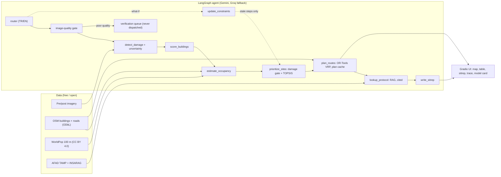
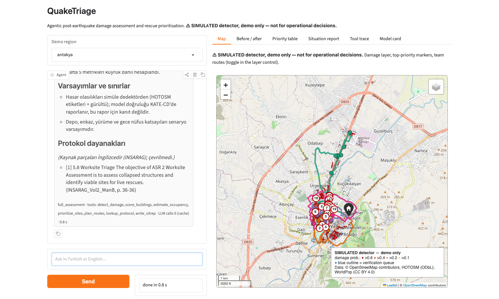

# QuakeTriage

**Agentic post-earthquake building damage assessment and rescue prioritization.**

> ⚠️ Research prototype only. Not validated for operational use in real search-and-rescue operations.
> Every Antakya result is produced with a **simulated detector** (HOTOSM labels + noise) and is labelled SIMULATED.


## Problem

After a large earthquake, coordinators have satellite imagery, a damage map and a handful of search-and-rescue teams:

> "The damage map is ready. Where should I send my limited teams first, by which route, and which buildings is the model unsure about?"

QuakeTriage turns pre/post-event imagery into a ranked, uncertainty-aware dispatch plan and a cited situation report,
and keeps a human in the loop: buildings the system is unsure about go to a field-verification queue instead of being ranked or dispatched.

## What it does

1. **Detect** damage from pre/post imagery (Siamese U-Net, 8-view TTA uncertainty) behind an image-quality guard.
2. **Score** buildings: occupancy estimate (WorldPop, night / full-occupancy scenarios), floors, uncertainty flags.
3. **Prioritise** with a damage gate and TOPSIS (AHP weights): only buildings above the damage threshold are candidates.
4. **Plan routes** with OR-Tools (prize-collecting VRP) over the OSM road graph, with debris-risk, closed roads and a walking leg.
5. **Ground advice** in AFAD TAMP and INSARAG guidelines (hybrid RAG, numbered citations, validated against the retrieved passages).
6. **Converse** (Turkish / English) through a LangGraph agent with nine tools; what-if questions re-run only the stale steps.
7. **Show** everything in a Gradio UI: map, priority table, downloadable situation report, tool trace, model card.

## Architecture



Details and decisions: [`docs/decisions.md`](docs/decisions.md), [`PLAN.md`](PLAN.md).

## Headline results

Real measurements and simulated ones are kept apart. The full machine-generated table is further down.

| Area | Result | Kind |
|---|---|---|
| Damage detection, KATE-CD test (38 tiles) | Siamese F1 **0.60** [0.50, 0.68] vs early-fusion baseline 0.50 [0.38, 0.59]; paired ΔF1 +0.10 [+0.04, +0.17]; single run per model | real |
| Uncertainty, KATE-CD test | 8-view TTA: ECE 0.008, uncertainty about 21x higher on wrong pixels | real |
| Protocol retrieval, 10 questions | recall@1 0.80, MRR 0.80 | real |
| Building-level damage in Antakya | not measured: the detector there is simulated | SIMULATED |
| Route plan, 400 candidates, 4 teams, 6 h | VRP collects 26.0 priority / 3,106 persons vs 22.9 / 2,749 (highest priority first), 12.1 / 430 (nearest first), 11.7 / 899 (random) | SIMULATED |
| Agent, 38 scripted scenarios, one cold run | task success **34 / 38**, tool selection 45 / 48 turns, 0 forbidden-behaviour violations, protocol answers citing the gold page 7 / 8 | real LLM, simulated detector |

**How to read the agent number.** The first run scored 30 / 38 (protocol 3 / 8). Between the runs three things changed together: the
TOPSIS damage gate, the citation-marker normalisation (`【1】` → `[1]`) and the protocol-retrieval fix (search with the user's original
message instead of the router's keyword rewrite). The re-run scored 34 / 38 (protocol 7 / 8). We did not run ablations that separate them, so no
single change is credited, and the planning numbers before and after the gate are not comparable (the gate removes intact crowded buildings
from the candidate set, 16,372 → 10,309 persons among candidates). The scenarios were written by the agent's developer, one run, non-deterministic LLM.



## Quickstart

Everything below uses free tiers only.

```bash
uv sync --all-extras               # plain `uv sync` drops the torch/agent extras and breaks the tests
cp .env.example .env               # add a free Gemini key (and optionally a Groq key); never commit .env
uv run pytest -q && uv run ruff check .
```

Data (not in the repository; sources and licenses in [`docs/data_card.md`](docs/data_card.md)):

```bash
uv run python scripts/download_demo_area.py   # OSM buildings/roads, WorldPop
uv run python scripts/download_docs.py        # AFAD TAMP + INSARAG PDFs
# HOTOSM destroyed-building polygons: download the GeoJSON from HDX (hotosm_tur_destroyed_buildings)
# into data/raw/hotosm/ (see docs/data_card.md); check_data.py lists what is missing.
uv run python scripts/extract_rag_text.py && uv run python scripts/build_rag_index.py
uv run python scripts/build_buildings.py      # Antakya demo set with the simulated detector
uv run python scripts/check_data.py           # sanity check of what you downloaded
```

Run the app (it serves over http; OSM map tiles do not load from `file://`):

```bash
uv run python -m quaketriage.ui.app           # http://127.0.0.1:7860
uv run python -m quaketriage.agent -i         # or talk to the agent in the terminal
```

- Route plans are cached on disk (`outputs/cache/plans`) and the UI limits the solver to 10 s (scripts use 30 s), so a repeated question answers in about a second.
- The **Before / after** tab only shows imagery you downloaded yourself (`scripts/download_kate_cd.py`); the images are not in this repository for licence reasons.
- Model weights (`*.pt`) are not distributed. Without `models/siamese_best.pt` the Antakya demo still runs (simulated detector); the Kilis crop inference needs the weights, which you can train with `scripts/train.py` or `kaggle/`.
- Map previews: `uv run python scripts/make_map.py` and `scripts/make_route_map.py`, then `python3 -m http.server 8000 --directory reports` (do not open them via `file://`: OSM tile servers reject requests without a Referer).
- Regenerate the results table in this README: `uv run python scripts/make_report.py` (`--check` in CI).

## Planning comparison (SIMULATED detector)

Antakya demo set, 400 candidate buildings, 4 teams, 6 h, 30 min per building, closed roads with a walking leg
(`reports/metrics_planning.json`; damage probabilities come from a simulated detector, the depot is a scenario
assumption):

| Method | Priority collected | Persons reached | Visits |
|---|---|---|---|
| OR-Tools prize-collecting VRP | 26.03 | 3,106 | 42 |
| Highest priority first | 22.94 | 2,749 | 36 |
| Nearest first (greedy) | 12.14 | 430 | 44 |
| Random (30 seeds, mean) | 11.72 | 899 | 35.6 |

Only buildings above the damage gate (`damage_prob` > 0.2) are candidates (see `docs/decisions.md`, 2026-11-10);
the pre-gate numbers (VRP 27.80 / 3,969 persons) are archived in `reports/archive/pre_gate/`. The VRP collects
**13 % more priority than the highest-priority-first rule**, 2.1x the nearest-first rule and 2.2x the random rule. These numbers describe planning behaviour on simulated detections, not rescue outcomes.

## Full results (generated)

<details><summary>All numbers from <code>reports/*.json</code> (generated by <code>make report</code>; do not edit by hand)</summary>

<!-- results:begin -->
| Report | Metric | Value |
|---|---|---|
| `ablation_uncertainty_filter` | `SIMULATED_DETECTOR` | True |
| `ablation_uncertainty_filter` | `disclaimer` | Measures the simulated noise model, not real model behaviour: simulated uncertainty peaks near the decision threshold and does not depend on whether the detector is right. k>1 rows are ASSUMED error-aware variants. |
| `ablation_uncertainty_filter` | `setup.miss_rate` | 0.2 |
| `ablation_uncertainty_filter` | `setup.false_alarm_rate` | 0.03 |
| `ablation_uncertainty_filter` | `setup.size_exponent` | 1 |
| `ablation_uncertainty_filter` | `setup.tau` | 0.2 |
| `ablation_uncertainty_filter` | `setup.top_n` | 400 |
| `ablation_uncertainty_filter` | `counts_by_k.k=1.filter_on.reported_tp.mean` | 576.6 |
| `ablation_uncertainty_filter` | `counts_by_k.k=1.filter_on.reported_tp.std` | 9 |
| `ablation_uncertainty_filter` | `counts_by_k.k=1.filter_on.reported_fp.mean` | 150 |
| `ablation_uncertainty_filter` | `counts_by_k.k=1.filter_on.reported_fp.std` | 11.6 |
| `ablation_uncertainty_filter` | `counts_by_k.k=1.filter_on.held_back_tp.mean` | 8.8 |
| `ablation_uncertainty_filter` | `counts_by_k.k=1.filter_on.held_back_tp.std` | 2 |
| `ablation_uncertainty_filter` | `counts_by_k.k=1.filter_on.held_back_fp.mean` | 3 |
| `ablation_uncertainty_filter` | `counts_by_k.k=1.filter_on.held_back_fp.std` | 1.9 |
| `ablation_uncertainty_filter` | `counts_by_k.k=1.filter_on.queue_size.mean` | 99.8 |
| `ablation_uncertainty_filter` | `counts_by_k.k=1.filter_on.queue_size.std` | 9.7 |
| `ablation_uncertainty_filter` | `counts_by_k.k=1.filter_on.topn_tp.mean` | 342.2 |
| `ablation_uncertainty_filter` | `counts_by_k.k=1.filter_on.topn_tp.std` | 7.6 |
| `ablation_uncertainty_filter` | `counts_by_k.k=1.filter_on.topn_fp.mean` | 57.8 |
| `ablation_uncertainty_filter` | `counts_by_k.k=1.filter_on.topn_fp.std` | 7.6 |
| `ablation_uncertainty_filter` | `counts_by_k.k=1.filter_off.reported_tp.mean` | 585.4 |
| `ablation_uncertainty_filter` | `counts_by_k.k=1.filter_off.reported_tp.std` | 8 |
| `ablation_uncertainty_filter` | `counts_by_k.k=1.filter_off.reported_fp.mean` | 153 |
| `ablation_uncertainty_filter` | `counts_by_k.k=1.filter_off.reported_fp.std` | 10 |
| `ablation_uncertainty_filter` | `counts_by_k.k=1.filter_off.held_back_tp.mean` | 0 |
| `ablation_uncertainty_filter` | `counts_by_k.k=1.filter_off.held_back_tp.std` | 0 |
| `ablation_uncertainty_filter` | `counts_by_k.k=1.filter_off.held_back_fp.mean` | 0 |
| `ablation_uncertainty_filter` | `counts_by_k.k=1.filter_off.held_back_fp.std` | 0 |
| `ablation_uncertainty_filter` | `counts_by_k.k=1.filter_off.queue_size.mean` | 0 |
| `ablation_uncertainty_filter` | `counts_by_k.k=1.filter_off.queue_size.std` | 0 |
| `ablation_uncertainty_filter` | `counts_by_k.k=1.filter_off.topn_tp.mean` | 343.2 |
| `ablation_uncertainty_filter` | `counts_by_k.k=1.filter_off.topn_tp.std` | 6.6 |
| `ablation_uncertainty_filter` | `counts_by_k.k=1.filter_off.topn_fp.mean` | 56.8 |
| `ablation_uncertainty_filter` | `counts_by_k.k=1.filter_off.topn_fp.std` | 6.6 |
| `ablation_uncertainty_filter` | `counts_by_k.k=1.ASSUMED` | False |
| `ablation_uncertainty_filter` | `counts_by_k.k=2.filter_on.reported_tp.mean` | 576.6 |
| `ablation_uncertainty_filter` | `counts_by_k.k=2.filter_on.reported_tp.std` | 9 |
| `ablation_uncertainty_filter` | `counts_by_k.k=2.filter_on.reported_fp.mean` | 141 |
| `ablation_uncertainty_filter` | `counts_by_k.k=2.filter_on.reported_fp.std` | 9.3 |
| `ablation_uncertainty_filter` | `counts_by_k.k=2.filter_on.held_back_tp.mean` | 8.8 |
| `ablation_uncertainty_filter` | `counts_by_k.k=2.filter_on.held_back_tp.std` | 2 |
| `ablation_uncertainty_filter` | `counts_by_k.k=2.filter_on.held_back_fp.mean` | 12 |
| `ablation_uncertainty_filter` | `counts_by_k.k=2.filter_on.held_back_fp.std` | 2.3 |
| `ablation_uncertainty_filter` | `counts_by_k.k=2.filter_on.queue_size.mean` | 157 |
| `ablation_uncertainty_filter` | `counts_by_k.k=2.filter_on.queue_size.std` | 6.1 |
| `ablation_uncertainty_filter` | `counts_by_k.k=2.filter_on.topn_tp.mean` | 343.4 |
| `ablation_uncertainty_filter` | `counts_by_k.k=2.filter_on.topn_tp.std` | 8.8 |
| `ablation_uncertainty_filter` | `counts_by_k.k=2.filter_on.topn_fp.mean` | 56.6 |
| `ablation_uncertainty_filter` | `counts_by_k.k=2.filter_on.topn_fp.std` | 8.8 |
| `ablation_uncertainty_filter` | `counts_by_k.k=2.filter_off.reported_tp.mean` | 585.4 |
| `ablation_uncertainty_filter` | `counts_by_k.k=2.filter_off.reported_tp.std` | 8 |
| `ablation_uncertainty_filter` | `counts_by_k.k=2.filter_off.reported_fp.mean` | 153 |
| `ablation_uncertainty_filter` | `counts_by_k.k=2.filter_off.reported_fp.std` | 10 |
| `ablation_uncertainty_filter` | `counts_by_k.k=2.filter_off.held_back_tp.mean` | 0 |
| `ablation_uncertainty_filter` | `counts_by_k.k=2.filter_off.held_back_tp.std` | 0 |
| `ablation_uncertainty_filter` | `counts_by_k.k=2.filter_off.held_back_fp.mean` | 0 |
| `ablation_uncertainty_filter` | `counts_by_k.k=2.filter_off.held_back_fp.std` | 0 |
| `ablation_uncertainty_filter` | `counts_by_k.k=2.filter_off.queue_size.mean` | 0 |
| `ablation_uncertainty_filter` | `counts_by_k.k=2.filter_off.queue_size.std` | 0 |
| `ablation_uncertainty_filter` | `counts_by_k.k=2.filter_off.topn_tp.mean` | 343.2 |
| `ablation_uncertainty_filter` | `counts_by_k.k=2.filter_off.topn_tp.std` | 6.6 |
| `ablation_uncertainty_filter` | `counts_by_k.k=2.filter_off.topn_fp.mean` | 56.8 |
| `ablation_uncertainty_filter` | `counts_by_k.k=2.filter_off.topn_fp.std` | 6.6 |
| `ablation_uncertainty_filter` | `counts_by_k.k=2.ASSUMED` | True |
| `ablation_uncertainty_filter` | `counts_by_k.k=3.filter_on.reported_tp.mean` | 576.6 |
| `ablation_uncertainty_filter` | `counts_by_k.k=3.filter_on.reported_tp.std` | 9 |
| `ablation_uncertainty_filter` | `counts_by_k.k=3.filter_on.reported_fp.mean` | 132.8 |
| `ablation_uncertainty_filter` | `counts_by_k.k=3.filter_on.reported_fp.std` | 10.4 |
| `ablation_uncertainty_filter` | `counts_by_k.k=3.filter_on.held_back_tp.mean` | 8.8 |
| `ablation_uncertainty_filter` | `counts_by_k.k=3.filter_on.held_back_tp.std` | 2 |
| `ablation_uncertainty_filter` | `counts_by_k.k=3.filter_on.held_back_fp.mean` | 20.2 |
| `ablation_uncertainty_filter` | `counts_by_k.k=3.filter_on.held_back_fp.std` | 5 |
| `ablation_uncertainty_filter` | `counts_by_k.k=3.filter_on.queue_size.mean` | 228.4 |
| `ablation_uncertainty_filter` | `counts_by_k.k=3.filter_on.queue_size.std` | 13.3 |
| `ablation_uncertainty_filter` | `counts_by_k.k=3.filter_on.topn_tp.mean` | 343.8 |
| `ablation_uncertainty_filter` | `counts_by_k.k=3.filter_on.topn_tp.std` | 8.4 |
| `ablation_uncertainty_filter` | `counts_by_k.k=3.filter_on.topn_fp.mean` | 56.2 |
| `ablation_uncertainty_filter` | `counts_by_k.k=3.filter_on.topn_fp.std` | 8.4 |
| `ablation_uncertainty_filter` | `counts_by_k.k=3.filter_off.reported_tp.mean` | 585.4 |
| `ablation_uncertainty_filter` | `counts_by_k.k=3.filter_off.reported_tp.std` | 8 |
| `ablation_uncertainty_filter` | `counts_by_k.k=3.filter_off.reported_fp.mean` | 153 |
| `ablation_uncertainty_filter` | `counts_by_k.k=3.filter_off.reported_fp.std` | 10 |
| `ablation_uncertainty_filter` | `counts_by_k.k=3.filter_off.held_back_tp.mean` | 0 |
| `ablation_uncertainty_filter` | `counts_by_k.k=3.filter_off.held_back_tp.std` | 0 |
| `ablation_uncertainty_filter` | `counts_by_k.k=3.filter_off.held_back_fp.mean` | 0 |
| `ablation_uncertainty_filter` | `counts_by_k.k=3.filter_off.held_back_fp.std` | 0 |
| `ablation_uncertainty_filter` | `counts_by_k.k=3.filter_off.queue_size.mean` | 0 |
| `ablation_uncertainty_filter` | `counts_by_k.k=3.filter_off.queue_size.std` | 0 |
| `ablation_uncertainty_filter` | `counts_by_k.k=3.filter_off.topn_tp.mean` | 343.2 |
| `ablation_uncertainty_filter` | `counts_by_k.k=3.filter_off.topn_tp.std` | 6.6 |
| `ablation_uncertainty_filter` | `counts_by_k.k=3.filter_off.topn_fp.mean` | 56.8 |
| `ablation_uncertainty_filter` | `counts_by_k.k=3.filter_off.topn_fp.std` | 6.6 |
| `ablation_uncertainty_filter` | `counts_by_k.k=3.ASSUMED` | True |
| `ablation_uncertainty_filter` | `counts_by_k.k=5.filter_on.reported_tp.mean` | 576.6 |
| `ablation_uncertainty_filter` | `counts_by_k.k=5.filter_on.reported_tp.std` | 9 |
| `ablation_uncertainty_filter` | `counts_by_k.k=5.filter_on.reported_fp.mean` | 116.2 |
| `ablation_uncertainty_filter` | `counts_by_k.k=5.filter_on.reported_fp.std` | 6.7 |
| `ablation_uncertainty_filter` | `counts_by_k.k=5.filter_on.held_back_tp.mean` | 8.8 |
| `ablation_uncertainty_filter` | `counts_by_k.k=5.filter_on.held_back_tp.std` | 2 |
| `ablation_uncertainty_filter` | `counts_by_k.k=5.filter_on.held_back_fp.mean` | 36.8 |
| `ablation_uncertainty_filter` | `counts_by_k.k=5.filter_on.held_back_fp.std` | 8.7 |
| `ablation_uncertainty_filter` | `counts_by_k.k=5.filter_on.queue_size.mean` | 276.4 |
| `ablation_uncertainty_filter` | `counts_by_k.k=5.filter_on.queue_size.std` | 10.9 |
| `ablation_uncertainty_filter` | `counts_by_k.k=5.filter_on.topn_tp.mean` | 345.4 |
| `ablation_uncertainty_filter` | `counts_by_k.k=5.filter_on.topn_tp.std` | 8.1 |
| `ablation_uncertainty_filter` | `counts_by_k.k=5.filter_on.topn_fp.mean` | 54.6 |
| `ablation_uncertainty_filter` | `counts_by_k.k=5.filter_on.topn_fp.std` | 8.1 |
| `ablation_uncertainty_filter` | `counts_by_k.k=5.filter_off.reported_tp.mean` | 585.4 |
| `ablation_uncertainty_filter` | `counts_by_k.k=5.filter_off.reported_tp.std` | 8 |
| `ablation_uncertainty_filter` | `counts_by_k.k=5.filter_off.reported_fp.mean` | 153 |
| `ablation_uncertainty_filter` | `counts_by_k.k=5.filter_off.reported_fp.std` | 10 |
| `ablation_uncertainty_filter` | `counts_by_k.k=5.filter_off.held_back_tp.mean` | 0 |
| `ablation_uncertainty_filter` | `counts_by_k.k=5.filter_off.held_back_tp.std` | 0 |
| `ablation_uncertainty_filter` | `counts_by_k.k=5.filter_off.held_back_fp.mean` | 0 |
| `ablation_uncertainty_filter` | `counts_by_k.k=5.filter_off.held_back_fp.std` | 0 |
| `ablation_uncertainty_filter` | `counts_by_k.k=5.filter_off.queue_size.mean` | 0 |
| `ablation_uncertainty_filter` | `counts_by_k.k=5.filter_off.queue_size.std` | 0 |
| `ablation_uncertainty_filter` | `counts_by_k.k=5.filter_off.topn_tp.mean` | 343.2 |
| `ablation_uncertainty_filter` | `counts_by_k.k=5.filter_off.topn_tp.std` | 6.6 |
| `ablation_uncertainty_filter` | `counts_by_k.k=5.filter_off.topn_fp.mean` | 56.8 |
| `ablation_uncertainty_filter` | `counts_by_k.k=5.filter_off.topn_fp.std` | 6.6 |
| `ablation_uncertainty_filter` | `counts_by_k.k=5.ASSUMED` | True |
| `ablation_uncertainty_filter` | `vrp_seed0_k1.filter_on.n_visited` | 42 |
| `ablation_uncertainty_filter` | `vrp_seed0_k1.filter_on.dispatched_true_destroyed` | 41 |
| `ablation_uncertainty_filter` | `vrp_seed0_k1.filter_on.dispatched_false_positive` | 1 |
| `ablation_uncertainty_filter` | `vrp_seed0_k1.filter_on.persons_reached` | 3043 |
| `ablation_uncertainty_filter` | `vrp_seed0_k1.filter_on.priority_collected` | 25.69 |
| `ablation_uncertainty_filter` | `vrp_seed0_k1.filter_on.n_excluded_verification` | 112 |
| `ablation_uncertainty_filter` | `vrp_seed0_k1.filter_off.n_visited` | 42 |
| `ablation_uncertainty_filter` | `vrp_seed0_k1.filter_off.dispatched_true_destroyed` | 41 |
| `ablation_uncertainty_filter` | `vrp_seed0_k1.filter_off.dispatched_false_positive` | 1 |
| `ablation_uncertainty_filter` | `vrp_seed0_k1.filter_off.persons_reached` | 3106 |
| `ablation_uncertainty_filter` | `vrp_seed0_k1.filter_off.priority_collected` | 26.03 |
| `ablation_uncertainty_filter` | `vrp_seed0_k1.filter_off.n_excluded_verification` | 0 |
| `ablation_uncertainty_filter` | `seconds` | 65 |
| `agent_eval` | `metrics.task_success.passed` | 34 |
| `agent_eval` | `metrics.task_success.total` | 38 |
| `agent_eval` | `metrics.task_success.rate` | 0.895 |
| `agent_eval` | `metrics.tool_selection_exact.passed` | 45 |
| `agent_eval` | `metrics.tool_selection_exact.total` | 48 |
| `agent_eval` | `metrics.tool_selection_exact.rate` | 0.938 |
| `agent_eval` | `metrics.forbidden_behaviour.total_violations` | 0 |
| `agent_eval` | `metrics.citation.cited_gold_page.passed` | 7 |
| `agent_eval` | `metrics.citation.cited_gold_page.total` | 8 |
| `agent_eval` | `metrics.citation.cited_gold_page.rate` | 0.875 |
| `agent_eval` | `metrics.citation.dangling_citations` | 0 |
| `agent_eval` | `metrics.citation.rough_support_sentences.passed` | 21 |
| `agent_eval` | `metrics.citation.rough_support_sentences.total` | 26 |
| `agent_eval` | `metrics.citation.rough_support_sentences.rate` | 0.808 |
| `agent_eval` | `metrics.citation.hand_reviewed.passed` | 6 |
| `agent_eval` | `metrics.citation.hand_reviewed.total` | 8 |
| `agent_eval` | `metrics.citation.hand_reviewed.rate` | 0.75 |
| `agent_eval` | `metrics.citation.hand_reviewed.wrong_answers` | 1 |
| `agent_eval` | `metrics.citation.hand_reviewed.honest_no_answer_but_info_exists` | 0 |
| `agent_eval` | `metrics.citation.hand_reviewed.scope` | all 8 protocol answers read against the source text |
| `agent_eval` | `metrics.citation.hand_reviewed.details.P01.verdict` | acceptable |
| `agent_eval` | `metrics.citation.hand_reviewed.details.P01.acceptable` | True |
| `agent_eval` | `metrics.citation.hand_reviewed.details.P01.note` | All listed purposes match Vol II Manual B p.31 (scope and magnitude, damage, resource needs, sectorisation plan, priorities, hazards, infrastructure, BoO). Omits 'on foot' from the means; harmless. |
| `agent_eval` | `metrics.citation.hand_reviewed.details.P02.verdict` | wrong_detail |
| `agent_eval` | `metrics.citation.hand_reviewed.details.P02.acceptable` | False |
| `agent_eval` | `metrics.citation.hand_reviewed.details.P02.note` | Content matches p.32-36, but the answer expands UCC as 'United Nations Coordination Centre'; the abbreviation list (p.5) says USAR Coordination Cell. Same defect as in the 2026-11-10 run; the acronym is not defined in the retrieved passage, so the model guessed. |
| `agent_eval` | `metrics.citation.hand_reviewed.details.P03.verdict` | acceptable |
| `agent_eval` | `metrics.citation.hand_reviewed.details.P03.acceptable` | True |
| `agent_eval` | `metrics.citation.hand_reviewed.details.P03.note` | Matches 5.5.1/5.5.2 on p.25 (span of control, planning, assignment, flexible sector size, early sectorisation, neighbourhoods/parishes). |
| `agent_eval` | `metrics.citation.hand_reviewed.details.P04.verdict` | wrong_answer |
| `agent_eval` | `metrics.citation.hand_reviewed.details.P04.acceptable` | False |
| `agent_eval` | `metrics.citation.hand_reviewed.details.P04.note` | Cites Vol II Manual B p.20 instead of the gold Vol III p.19. Re-reading the source: the list of tasks (assess the collapsed structure, interview the public, decide access points and safe havens, staff accounting) is the task list of USAR Team Rescue; only the risk/hazard analysis belongs to USAR Team Search. The answer presents rescue-team tasks as prerequisites of a technical search. The gold passage (Vol III p.19: safety and security plan, risk assessment before search, search strategy, locals' information, surface line and hail search first) is not retrieved. NOTE: the 2026-11-10 hand note called this an acceptable alternative source and said the passage lists search-team tasks; that was wrong and is superseded here. |
| `agent_eval` | `metrics.citation.hand_reviewed.details.P05.verdict` | acceptable |
| `agent_eval` | `metrics.citation.hand_reviewed.details.P05.acceptable` | True |
| `agent_eval` | `metrics.citation.hand_reviewed.details.P05.note` | 'In consultation with medical personnel' matches Vol III p.23. 'At the rescue worksite' is an inference from the surrounding operations table (the passage does not name a place), so the 'where' part is thin but not wrong. |
| `agent_eval` | `metrics.citation.hand_reviewed.details.P06.verdict` | acceptable |
| `agent_eval` | `metrics.citation.hand_reviewed.details.P06.acceptable` | True |
| `agent_eval` | `metrics.citation.hand_reviewed.details.P06.note` | Preparedness, response, early recovery (hazirlik, mudahale, on iyilestirme) match TAMP p.18. |
| `agent_eval` | `metrics.citation.hand_reviewed.details.P07.verdict` | acceptable |
| `agent_eval` | `metrics.citation.hand_reviewed.details.P07.acceptable` | True |
| `agent_eval` | `metrics.citation.hand_reviewed.details.P07.note` | Two sub-services (Emergency Services, Early Recovery Services) match TAMP p.25; does not list the working groups, which the question did not strictly require. |
| `agent_eval` | `metrics.citation.hand_reviewed.details.P08.verdict` | acceptable |
| `agent_eval` | `metrics.citation.hand_reviewed.details.P08.acceptable` | True |
| `agent_eval` | `metrics.citation.hand_reviewed.details.P08.note` | Law no. 5902 matches TAMP p.3. |
| `agent_eval` | `metrics.latency_s_per_turn.mean` | 23.61 |
| `agent_eval` | `metrics.latency_s_per_turn.p50` | 32.24 |
| `agent_eval` | `metrics.latency_s_per_turn.p95` | 33.84 |
| `agent_eval` | `metrics.latency_s_per_turn.max` | 47.42 |
| `agent_eval` | `metrics.llm.calls_total` | 163 |
| `agent_eval` | `metrics.llm.successful_answers` | 52 |
| `agent_eval` | `metrics.llm.answers_by_provider.gemini` | 25 |
| `agent_eval` | `metrics.llm.answers_by_provider.groq` | 27 |
| `comparison_siamese_vs_baseline_f1` | `threshold_mode` | f1 |
| `comparison_siamese_vs_baseline_f1` | `selected_on` | validation |
| `comparison_siamese_vs_baseline_f1` | `evaluated_on` | test |
| `comparison_siamese_vs_baseline_f1` | `n_test` | 38 |
| `comparison_siamese_vs_baseline_f1` | `models.early_fusion.threshold` | 0.2 |
| `comparison_siamese_vs_baseline_f1` | `models.early_fusion.metrics.precision` | 0.6354 |
| `comparison_siamese_vs_baseline_f1` | `models.early_fusion.metrics.recall` | 0.4145 |
| `comparison_siamese_vs_baseline_f1` | `models.early_fusion.metrics.f1` | 0.5017 |
| `comparison_siamese_vs_baseline_f1` | `models.early_fusion.metrics.iou` | 0.3348 |
| `comparison_siamese_vs_baseline_f1` | `models.siamese.threshold` | 0.2 |
| `comparison_siamese_vs_baseline_f1` | `models.siamese.metrics.precision` | 0.7319 |
| `comparison_siamese_vs_baseline_f1` | `models.siamese.metrics.recall` | 0.5108 |
| `comparison_siamese_vs_baseline_f1` | `models.siamese.metrics.f1` | 0.6017 |
| `comparison_siamese_vs_baseline_f1` | `models.siamese.metrics.iou` | 0.4303 |
| `comparison_siamese_vs_baseline_f1` | `paired_bootstrap_siamese_minus_baseline.f1.metric` | f1 |
| `comparison_siamese_vs_baseline_f1` | `paired_bootstrap_siamese_minus_baseline.f1.mean_diff` | 0.1038 |
| `comparison_siamese_vs_baseline_f1` | `paired_bootstrap_siamese_minus_baseline.f1.ci95_lo` | 0.03829 |
| `comparison_siamese_vs_baseline_f1` | `paired_bootstrap_siamese_minus_baseline.f1.ci95_hi` | 0.1657 |
| `comparison_siamese_vs_baseline_f1` | `paired_bootstrap_siamese_minus_baseline.f1.p_not_better` | 0 |
| `comparison_siamese_vs_baseline_f1` | `paired_bootstrap_siamese_minus_baseline.iou.metric` | iou |
| `comparison_siamese_vs_baseline_f1` | `paired_bootstrap_siamese_minus_baseline.iou.mean_diff` | 0.09857 |
| `comparison_siamese_vs_baseline_f1` | `paired_bootstrap_siamese_minus_baseline.iou.ci95_lo` | 0.03736 |
| `comparison_siamese_vs_baseline_f1` | `paired_bootstrap_siamese_minus_baseline.iou.ci95_hi` | 0.155 |
| `comparison_siamese_vs_baseline_f1` | `paired_bootstrap_siamese_minus_baseline.iou.p_not_better` | 0 |
| `comparison_siamese_vs_baseline_f1` | `paired_bootstrap_siamese_minus_baseline.precision.metric` | precision |
| `comparison_siamese_vs_baseline_f1` | `paired_bootstrap_siamese_minus_baseline.precision.mean_diff` | 0.09649 |
| `comparison_siamese_vs_baseline_f1` | `paired_bootstrap_siamese_minus_baseline.precision.ci95_lo` | -0.003213 |
| `comparison_siamese_vs_baseline_f1` | `paired_bootstrap_siamese_minus_baseline.precision.ci95_hi` | 0.1961 |
| `comparison_siamese_vs_baseline_f1` | `paired_bootstrap_siamese_minus_baseline.precision.p_not_better` | 0.03 |
| `comparison_siamese_vs_baseline_f1` | `paired_bootstrap_siamese_minus_baseline.recall.metric` | recall |
| `comparison_siamese_vs_baseline_f1` | `paired_bootstrap_siamese_minus_baseline.recall.mean_diff` | 0.09901 |
| `comparison_siamese_vs_baseline_f1` | `paired_bootstrap_siamese_minus_baseline.recall.ci95_lo` | 0.01546 |
| `comparison_siamese_vs_baseline_f1` | `paired_bootstrap_siamese_minus_baseline.recall.ci95_hi` | 0.1749 |
| `comparison_siamese_vs_baseline_f1` | `paired_bootstrap_siamese_minus_baseline.recall.p_not_better` | 0.011 |
| `comparison_siamese_vs_baseline_f2` | `threshold_mode` | f2 |
| `comparison_siamese_vs_baseline_f2` | `selected_on` | validation |
| `comparison_siamese_vs_baseline_f2` | `evaluated_on` | test |
| `comparison_siamese_vs_baseline_f2` | `n_test` | 38 |
| `comparison_siamese_vs_baseline_f2` | `models.early_fusion.threshold` | 0.01 |
| `comparison_siamese_vs_baseline_f2` | `models.early_fusion.metrics.precision` | 0.5238 |
| `comparison_siamese_vs_baseline_f2` | `models.early_fusion.metrics.recall` | 0.5072 |
| `comparison_siamese_vs_baseline_f2` | `models.early_fusion.metrics.f1` | 0.5154 |
| `comparison_siamese_vs_baseline_f2` | `models.early_fusion.metrics.iou` | 0.3472 |
| `comparison_siamese_vs_baseline_f2` | `models.siamese.threshold` | 0.02 |
| `comparison_siamese_vs_baseline_f2` | `models.siamese.metrics.precision` | 0.5983 |
| `comparison_siamese_vs_baseline_f2` | `models.siamese.metrics.recall` | 0.5881 |
| `comparison_siamese_vs_baseline_f2` | `models.siamese.metrics.f1` | 0.5932 |
| `comparison_siamese_vs_baseline_f2` | `models.siamese.metrics.iou` | 0.4217 |
| `comparison_siamese_vs_baseline_f2` | `paired_bootstrap_siamese_minus_baseline.f1.metric` | f1 |
| `comparison_siamese_vs_baseline_f2` | `paired_bootstrap_siamese_minus_baseline.f1.mean_diff` | 0.08053 |
| `comparison_siamese_vs_baseline_f2` | `paired_bootstrap_siamese_minus_baseline.f1.ci95_lo` | 0.03199 |
| `comparison_siamese_vs_baseline_f2` | `paired_bootstrap_siamese_minus_baseline.f1.ci95_hi` | 0.1351 |
| `comparison_siamese_vs_baseline_f2` | `paired_bootstrap_siamese_minus_baseline.f1.p_not_better` | 0 |
| `comparison_siamese_vs_baseline_f2` | `paired_bootstrap_siamese_minus_baseline.iou.metric` | iou |
| `comparison_siamese_vs_baseline_f2` | `paired_bootstrap_siamese_minus_baseline.iou.mean_diff` | 0.07666 |
| `comparison_siamese_vs_baseline_f2` | `paired_bootstrap_siamese_minus_baseline.iou.ci95_lo` | 0.03157 |
| `comparison_siamese_vs_baseline_f2` | `paired_bootstrap_siamese_minus_baseline.iou.ci95_hi` | 0.1238 |
| `comparison_siamese_vs_baseline_f2` | `paired_bootstrap_siamese_minus_baseline.iou.p_not_better` | 0 |
| `comparison_siamese_vs_baseline_f2` | `paired_bootstrap_siamese_minus_baseline.precision.metric` | precision |
| `comparison_siamese_vs_baseline_f2` | `paired_bootstrap_siamese_minus_baseline.precision.mean_diff` | 0.07431 |
| `comparison_siamese_vs_baseline_f2` | `paired_bootstrap_siamese_minus_baseline.precision.ci95_lo` | -0.005027 |
| `comparison_siamese_vs_baseline_f2` | `paired_bootstrap_siamese_minus_baseline.precision.ci95_hi` | 0.1536 |
| `comparison_siamese_vs_baseline_f2` | `paired_bootstrap_siamese_minus_baseline.precision.p_not_better` | 0.039 |
| `comparison_siamese_vs_baseline_f2` | `paired_bootstrap_siamese_minus_baseline.recall.metric` | recall |
| `comparison_siamese_vs_baseline_f2` | `paired_bootstrap_siamese_minus_baseline.recall.mean_diff` | 0.08349 |
| `comparison_siamese_vs_baseline_f2` | `paired_bootstrap_siamese_minus_baseline.recall.ci95_lo` | 0.006421 |
| `comparison_siamese_vs_baseline_f2` | `paired_bootstrap_siamese_minus_baseline.recall.ci95_hi` | 0.1628 |
| `comparison_siamese_vs_baseline_f2` | `paired_bootstrap_siamese_minus_baseline.recall.p_not_better` | 0.016 |
| `depot_sensitivity` | `n_buildings` | 5895 |
| `depot_sensitivity` | `alternatives.hospital (OSM way 366665647).spearman` | 0.9997 |
| `depot_sensitivity` | `alternatives.hospital (OSM way 366665647).top100_overlap` | 0.97 |
| `depot_sensitivity` | `alternatives.hospital (OSM way 366665647).top500_overlap` | 0.942 |
| `depot_sensitivity` | `alternatives.town hall (OSM way 311391399).spearman` | 0.9997 |
| `depot_sensitivity` | `alternatives.town hall (OSM way 311391399).top100_overlap` | 0.93 |
| `depot_sensitivity` | `alternatives.town hall (OSM way 311391399).top500_overlap` | 0.912 |
| `error_analysis` | `kate_cd_siamese.split` | test |
| `error_analysis` | `kate_cd_siamese.threshold` | 0.2 |
| `error_analysis` | `kate_cd_siamese.n_tiles` | 38 |
| `error_analysis` | `kate_cd_siamese.n_tiles_with_any_damage_or_prediction` | 38 |
| `error_analysis` | `kate_cd_siamese.n_worst_false_alarm` | 0 |
| `error_analysis` | `kate_cd_siamese.n_worst_missed_damage` | 10 |
| `error_analysis` | `kate_cd_siamese.note` | KATE-CD tiles, not buildings (no building labels there). |
| `error_analysis` | `antakya_simulated.SIMULATED_DETECTOR` | True |
| `error_analysis` | `antakya_simulated.definition` | highest-priority buildings that are NOT destroyed in HOTOSM truth and not in the verification queue; truth is incomplete, so some may be real damage |
| `metrics_baseline` | `checkpoint` | baseline_best.pt |
| `metrics_baseline` | `model` | early_fusion |
| `metrics_baseline` | `split` | test |
| `metrics_baseline` | `encoder` | resnet34 |
| `metrics_baseline` | `trained_epoch` | 33 |
| `metrics_baseline` | `best_val_f1` | 0.5196 |
| `metrics_baseline` | `threshold` | 0.5 |
| `metrics_baseline` | `threshold_selection.mode` | ckpt |
| `metrics_baseline` | `n_samples` | 38 |
| `metrics_baseline` | `metrics.precision` | 0.6573 |
| `metrics_baseline` | `metrics.recall` | 0.3908 |
| `metrics_baseline` | `metrics.f1` | 0.4901 |
| `metrics_baseline` | `metrics.iou` | 0.3246 |
| `metrics_baseline` | `bootstrap_ci.precision.mean` | 0.6599 |
| `metrics_baseline` | `bootstrap_ci.precision.ci95_lo` | 0.5513 |
| `metrics_baseline` | `bootstrap_ci.precision.ci95_hi` | 0.7598 |
| `metrics_baseline` | `bootstrap_ci.recall.mean` | 0.3886 |
| `metrics_baseline` | `bootstrap_ci.recall.ci95_lo` | 0.259 |
| `metrics_baseline` | `bootstrap_ci.recall.ci95_hi` | 0.5114 |
| `metrics_baseline` | `bootstrap_ci.f1.mean` | 0.4854 |
| `metrics_baseline` | `bootstrap_ci.f1.ci95_lo` | 0.3702 |
| `metrics_baseline` | `bootstrap_ci.f1.ci95_hi` | 0.5818 |
| `metrics_baseline` | `bootstrap_ci.iou.mean` | 0.3224 |
| `metrics_baseline` | `bootstrap_ci.iou.ci95_lo` | 0.2272 |
| `metrics_baseline` | `bootstrap_ci.iou.ci95_hi` | 0.4102 |
| `metrics_baseline` | `inference_secs` | 3.6 |
| `metrics_baseline_f1` | `checkpoint` | baseline_best.pt |
| `metrics_baseline_f1` | `model` | early_fusion |
| `metrics_baseline_f1` | `split` | test |
| `metrics_baseline_f1` | `encoder` | resnet34 |
| `metrics_baseline_f1` | `trained_epoch` | 33 |
| `metrics_baseline_f1` | `best_val_f1` | 0.5196 |
| `metrics_baseline_f1` | `threshold` | 0.2 |
| `metrics_baseline_f1` | `threshold_selection.mode` | f1 |
| `metrics_baseline_f1` | `threshold_selection.selected_on` | validation |
| `metrics_baseline_f1` | `threshold_selection.objective` | F1 |
| `metrics_baseline_f1` | `threshold_selection.value` | 0.521 |
| `metrics_baseline_f1` | `n_samples` | 38 |
| `metrics_baseline_f1` | `metrics.precision` | 0.6354 |
| `metrics_baseline_f1` | `metrics.recall` | 0.4145 |
| `metrics_baseline_f1` | `metrics.f1` | 0.5017 |
| `metrics_baseline_f1` | `metrics.iou` | 0.3348 |
| `metrics_baseline_f1` | `bootstrap_ci.precision.mean` | 0.638 |
| `metrics_baseline_f1` | `bootstrap_ci.precision.ci95_lo` | 0.5293 |
| `metrics_baseline_f1` | `bootstrap_ci.precision.ci95_hi` | 0.7381 |
| `metrics_baseline_f1` | `bootstrap_ci.recall.mean` | 0.4125 |
| `metrics_baseline_f1` | `bootstrap_ci.recall.ci95_lo` | 0.281 |
| `metrics_baseline_f1` | `bootstrap_ci.recall.ci95_hi` | 0.5366 |
| `metrics_baseline_f1` | `bootstrap_ci.f1.mean` | 0.4973 |
| `metrics_baseline_f1` | `bootstrap_ci.f1.ci95_lo` | 0.3813 |
| `metrics_baseline_f1` | `bootstrap_ci.f1.ci95_hi` | 0.592 |
| `metrics_baseline_f1` | `bootstrap_ci.iou.mean` | 0.3328 |
| `metrics_baseline_f1` | `bootstrap_ci.iou.ci95_lo` | 0.2356 |
| `metrics_baseline_f1` | `bootstrap_ci.iou.ci95_hi` | 0.4204 |
| `metrics_baseline_f1` | `inference_secs` | 3 |
| `metrics_baseline_f2` | `checkpoint` | baseline_best.pt |
| `metrics_baseline_f2` | `model` | early_fusion |
| `metrics_baseline_f2` | `split` | test |
| `metrics_baseline_f2` | `encoder` | resnet34 |
| `metrics_baseline_f2` | `trained_epoch` | 33 |
| `metrics_baseline_f2` | `best_val_f1` | 0.5196 |
| `metrics_baseline_f2` | `threshold` | 0.01 |
| `metrics_baseline_f2` | `threshold_selection.mode` | f2 |
| `metrics_baseline_f2` | `threshold_selection.selected_on` | validation |
| `metrics_baseline_f2` | `threshold_selection.objective` | F2 |
| `metrics_baseline_f2` | `threshold_selection.value` | 0.5508 |
| `metrics_baseline_f2` | `n_samples` | 38 |
| `metrics_baseline_f2` | `metrics.precision` | 0.5238 |
| `metrics_baseline_f2` | `metrics.recall` | 0.5072 |
| `metrics_baseline_f2` | `metrics.f1` | 0.5154 |
| `metrics_baseline_f2` | `metrics.iou` | 0.3472 |
| `metrics_baseline_f2` | `bootstrap_ci.precision.mean` | 0.5255 |
| `metrics_baseline_f2` | `bootstrap_ci.precision.ci95_lo` | 0.4158 |
| `metrics_baseline_f2` | `bootstrap_ci.precision.ci95_hi` | 0.6229 |
| `metrics_baseline_f2` | `bootstrap_ci.recall.mean` | 0.5059 |
| `metrics_baseline_f2` | `bootstrap_ci.recall.ci95_lo` | 0.3532 |
| `metrics_baseline_f2` | `bootstrap_ci.recall.ci95_hi` | 0.6389 |
| `metrics_baseline_f2` | `bootstrap_ci.f1.mean` | 0.5124 |
| `metrics_baseline_f2` | `bootstrap_ci.f1.ci95_lo` | 0.4081 |
| `metrics_baseline_f2` | `bootstrap_ci.f1.ci95_hi` | 0.6033 |
| `metrics_baseline_f2` | `bootstrap_ci.iou.mean` | 0.346 |
| `metrics_baseline_f2` | `bootstrap_ci.iou.ci95_lo` | 0.2563 |
| `metrics_baseline_f2` | `bootstrap_ci.iou.ci95_hi` | 0.432 |
| `metrics_baseline_f2` | `inference_secs` | 3.1 |
| `metrics_building` | `SIMULATED_DETECTOR` | True |
| `metrics_building` | `disclaimer` | damage_prob/uncertainty are simulated from HOTOSM labels; these numbers measure planning-pipeline robustness to detector noise, NOT model accuracy. Recall/precision follow from the chosen miss/false-alarm rates by construction. queue_share is NOT informative here: simulated uncertainty does not depend on whether the detector is right (on KATE-CD real uncertainty is 14-21x higher on wrong pixels, reports/uncertainty_*.json). |
| `metrics_building` | `n_buildings` | 5895 |
| `metrics_building` | `n_destroyed_truth` | 732 |
| `metrics_building` | `demo_set.zone_buffer_m` | 100 |
| `metrics_building` | `demo_set.osm_footprints_overlapping_hotosm` | 8 |
| `metrics_building` | `demo_set.note` | destroyed footprints come from HOTOSM; others are nearby OSM buildings |
| `metrics_building` | `base_scenario.miss_rate` | 0.2 |
| `metrics_building` | `base_scenario.false_alarm_rate` | 0.03 |
| `metrics_building` | `base_scenario.size_exponent` | 1 |
| `metrics_building` | `base_scenario.seed` | 0 |
| `metrics_building` | `base_scenario.metrics.n` | 5895 |
| `metrics_building` | `base_scenario.metrics.n_truth` | 732 |
| `metrics_building` | `base_scenario.metrics.tp` | 593 |
| `metrics_building` | `base_scenario.metrics.fp` | 141 |
| `metrics_building` | `base_scenario.metrics.fn` | 139 |
| `metrics_building` | `base_scenario.metrics.precision` | 0.8079 |
| `metrics_building` | `base_scenario.metrics.recall` | 0.8101 |
| `metrics_building` | `base_scenario.metrics.f1` | 0.809 |
| `metrics_building` | `base_scenario.metrics.persons_in_destroyed` | 1.252e+04 |
| `metrics_building` | `base_scenario.metrics.person_recall` | 0.9275 |
| `metrics_building` | `base_scenario.queue_share` | 0.019 |
| `metrics_building` | `population.residents_day` | 6.177e+04 |
| `metrics_building` | `population.estimated_persons_night` | 5.463e+04 |
| `metrics_building` | `n_seeds` | 5 |
| `metrics_eda` | `train.n_samples` | 404 |
| `metrics_eda` | `train.mean_damaged_ratio` | 0.03669 |
| `metrics_eda` | `train.median_damaged_ratio` | 0.02069 |
| `metrics_eda` | `train.pct_with_any_damage` | 1 |
| `metrics_eda` | `validation.n_samples` | 44 |
| `metrics_eda` | `validation.mean_damaged_ratio` | 0.03204 |
| `metrics_eda` | `validation.median_damaged_ratio` | 0.01701 |
| `metrics_eda` | `validation.pct_with_any_damage` | 1 |
| `metrics_eda` | `test.n_samples` | 38 |
| `metrics_eda` | `test.mean_damaged_ratio` | 0.02825 |
| `metrics_eda` | `test.median_damaged_ratio` | 0.02032 |
| `metrics_eda` | `test.pct_with_any_damage` | 1 |
| `metrics_planning` | `SIMULATED_DETECTOR` | True |
| `metrics_planning` | `disclaimer` | Damage probabilities come from a simulated detector (HOTOSM labels + noise); depot, debris and walking rules are scenario assumptions; numbers show planning behaviour, not real-world rescue outcomes. |
| `metrics_planning` | `n_buildings` | 5895 |
| `metrics_planning` | `params.num_teams` | 4 |
| `metrics_planning` | `params.mission_duration_hours` | 6 |
| `metrics_planning` | `params.intervention_time_minutes` | 30 |
| `metrics_planning` | `params.solver_time_limit_s` | 30 |
| `metrics_planning` | `params.candidate_n` | 400 |
| `metrics_planning` | `params.debris_risk_buffer_meters` | 50 |
| `metrics_planning` | `params.debris_damage_prob_min` | 0.5 |
| `metrics_planning` | `params.debris_min_floors` | 3 |
| `metrics_planning` | `params.debris_penalty_factor` | 3 |
| `metrics_planning` | `params.debris_block_count` | 5 |
| `metrics_planning` | `params.walking_speed_kmh` | 3 |
| `metrics_planning` | `params.max_walk_m` | 500 |
| `metrics_planning` | `variants_at_candidate_n.n` | 400 |
| `metrics_planning` | `variants_at_candidate_n.no_closures.n_candidates` | 400 |
| `metrics_planning` | `variants_at_candidate_n.no_closures.n_unreachable` | 0 |
| `metrics_planning` | `variants_at_candidate_n.no_closures.n_need_walking` | 0 |
| `metrics_planning` | `variants_at_candidate_n.no_closures.n_visited` | 44 |
| `metrics_planning` | `variants_at_candidate_n.no_closures.priority_collected` | 26.93 |
| `metrics_planning` | `variants_at_candidate_n.no_closures.persons_reached` | 3198 |
| `metrics_planning` | `variants_at_candidate_n.no_closures.persons_in_candidates` | 1.031e+04 |
| `metrics_planning` | `variants_at_candidate_n.no_closures.solve_s` | 30.2 |
| `metrics_planning` | `variants_at_candidate_n.no_closures.n_unreachable_all_buildings` | 0 |
| `metrics_planning` | `variants_at_candidate_n.closures_no_walking.n_candidates` | 274 |
| `metrics_planning` | `variants_at_candidate_n.closures_no_walking.n_unreachable` | 126 |
| `metrics_planning` | `variants_at_candidate_n.closures_no_walking.n_need_walking` | 0 |
| `metrics_planning` | `variants_at_candidate_n.closures_no_walking.n_visited` | 43 |
| `metrics_planning` | `variants_at_candidate_n.closures_no_walking.priority_collected` | 24.2 |
| `metrics_planning` | `variants_at_candidate_n.closures_no_walking.persons_reached` | 2825 |
| `metrics_planning` | `variants_at_candidate_n.closures_no_walking.persons_in_candidates` | 7347 |
| `metrics_planning` | `variants_at_candidate_n.closures_no_walking.solve_s` | 30.3 |
| `metrics_planning` | `variants_at_candidate_n.closures_no_walking.n_unreachable_all_buildings` | 1139 |
| `metrics_planning` | `variants_at_candidate_n.closures_with_walking.n_candidates` | 400 |
| `metrics_planning` | `variants_at_candidate_n.closures_with_walking.n_unreachable` | 0 |
| `metrics_planning` | `variants_at_candidate_n.closures_with_walking.n_need_walking` | 126 |
| `metrics_planning` | `variants_at_candidate_n.closures_with_walking.n_visited` | 42 |
| `metrics_planning` | `variants_at_candidate_n.closures_with_walking.priority_collected` | 26.03 |
| `metrics_planning` | `variants_at_candidate_n.closures_with_walking.persons_reached` | 3106 |
| `metrics_planning` | `variants_at_candidate_n.closures_with_walking.persons_in_candidates` | 1.031e+04 |
| `metrics_planning` | `variants_at_candidate_n.closures_with_walking.solve_s` | 30.1 |
| `metrics_planning` | `variants_at_candidate_n.closures_with_walking.n_unreachable_all_buildings` | 0 |
| `metrics_planning` | `candidate_n_sensitivity_closures_with_walking.200.n_candidates` | 200 |
| `metrics_planning` | `candidate_n_sensitivity_closures_with_walking.200.n_unreachable` | 0 |
| `metrics_planning` | `candidate_n_sensitivity_closures_with_walking.200.n_need_walking` | 54 |
| `metrics_planning` | `candidate_n_sensitivity_closures_with_walking.200.n_visited` | 42 |
| `metrics_planning` | `candidate_n_sensitivity_closures_with_walking.200.priority_collected` | 26.03 |
| `metrics_planning` | `candidate_n_sensitivity_closures_with_walking.200.persons_reached` | 3106 |
| `metrics_planning` | `candidate_n_sensitivity_closures_with_walking.200.persons_in_candidates` | 8049 |
| `metrics_planning` | `candidate_n_sensitivity_closures_with_walking.200.solve_s` | 30.2 |
| `metrics_planning` | `candidate_n_sensitivity_closures_with_walking.400.n_candidates` | 400 |
| `metrics_planning` | `candidate_n_sensitivity_closures_with_walking.400.n_unreachable` | 0 |
| `metrics_planning` | `candidate_n_sensitivity_closures_with_walking.400.n_need_walking` | 126 |
| `metrics_planning` | `candidate_n_sensitivity_closures_with_walking.400.n_visited` | 42 |
| `metrics_planning` | `candidate_n_sensitivity_closures_with_walking.400.priority_collected` | 26.03 |
| `metrics_planning` | `candidate_n_sensitivity_closures_with_walking.400.persons_reached` | 3106 |
| `metrics_planning` | `candidate_n_sensitivity_closures_with_walking.400.persons_in_candidates` | 1.031e+04 |
| `metrics_planning` | `candidate_n_sensitivity_closures_with_walking.400.solve_s` | 30.1 |
| `metrics_planning` | `candidate_n_sensitivity_closures_with_walking.500.n_candidates` | 500 |
| `metrics_planning` | `candidate_n_sensitivity_closures_with_walking.500.n_unreachable` | 0 |
| `metrics_planning` | `candidate_n_sensitivity_closures_with_walking.500.n_need_walking` | 159 |
| `metrics_planning` | `candidate_n_sensitivity_closures_with_walking.500.n_visited` | 41 |
| `metrics_planning` | `candidate_n_sensitivity_closures_with_walking.500.priority_collected` | 25.55 |
| `metrics_planning` | `candidate_n_sensitivity_closures_with_walking.500.persons_reached` | 3052 |
| `metrics_planning` | `candidate_n_sensitivity_closures_with_walking.500.persons_in_candidates` | 1.116e+04 |
| `metrics_planning` | `candidate_n_sensitivity_closures_with_walking.500.solve_s` | 30.3 |
| `metrics_planning` | `candidate_n_sensitivity_closures_with_walking.1000.n_candidates` | 734 |
| `metrics_planning` | `candidate_n_sensitivity_closures_with_walking.1000.n_unreachable` | 0 |
| `metrics_planning` | `candidate_n_sensitivity_closures_with_walking.1000.n_need_walking` | 230 |
| `metrics_planning` | `candidate_n_sensitivity_closures_with_walking.1000.n_visited` | 42 |
| `metrics_planning` | `candidate_n_sensitivity_closures_with_walking.1000.priority_collected` | 26.02 |
| `metrics_planning` | `candidate_n_sensitivity_closures_with_walking.1000.persons_reached` | 3102 |
| `metrics_planning` | `candidate_n_sensitivity_closures_with_walking.1000.persons_in_candidates` | 1.246e+04 |
| `metrics_planning` | `candidate_n_sensitivity_closures_with_walking.1000.solve_s` | 30.3 |
| `metrics_planning` | `baselines_closures_with_walking.n` | 400 |
| `metrics_planning` | `baselines_closures_with_walking.vrp.n_candidates` | 400 |
| `metrics_planning` | `baselines_closures_with_walking.vrp.n_unreachable` | 0 |
| `metrics_planning` | `baselines_closures_with_walking.vrp.n_need_walking` | 126 |
| `metrics_planning` | `baselines_closures_with_walking.vrp.n_visited` | 42 |
| `metrics_planning` | `baselines_closures_with_walking.vrp.priority_collected` | 26.03 |
| `metrics_planning` | `baselines_closures_with_walking.vrp.persons_reached` | 3106 |
| `metrics_planning` | `baselines_closures_with_walking.vrp.persons_in_candidates` | 1.031e+04 |
| `metrics_planning` | `baselines_closures_with_walking.vrp.solve_s` | 30.1 |
| `metrics_planning` | `baselines_closures_with_walking.vrp.priority_vs_random_mean_x` | 2.22 |
| `metrics_planning` | `baselines_closures_with_walking.greedy_nearest.n_candidates` | 400 |
| `metrics_planning` | `baselines_closures_with_walking.greedy_nearest.n_unreachable` | 0 |
| `metrics_planning` | `baselines_closures_with_walking.greedy_nearest.n_need_walking` | 126 |
| `metrics_planning` | `baselines_closures_with_walking.greedy_nearest.n_visited` | 44 |
| `metrics_planning` | `baselines_closures_with_walking.greedy_nearest.priority_collected` | 12.14 |
| `metrics_planning` | `baselines_closures_with_walking.greedy_nearest.persons_reached` | 429.9 |
| `metrics_planning` | `baselines_closures_with_walking.greedy_nearest.persons_in_candidates` | 1.031e+04 |
| `metrics_planning` | `baselines_closures_with_walking.greedy_nearest.solve_s` | 0 |
| `metrics_planning` | `baselines_closures_with_walking.greedy_nearest.priority_vs_random_mean_x` | 1.04 |
| `metrics_planning` | `baselines_closures_with_walking.priority_first.n_candidates` | 400 |
| `metrics_planning` | `baselines_closures_with_walking.priority_first.n_unreachable` | 0 |
| `metrics_planning` | `baselines_closures_with_walking.priority_first.n_need_walking` | 126 |
| `metrics_planning` | `baselines_closures_with_walking.priority_first.n_visited` | 36 |
| `metrics_planning` | `baselines_closures_with_walking.priority_first.priority_collected` | 22.94 |
| `metrics_planning` | `baselines_closures_with_walking.priority_first.persons_reached` | 2749 |
| `metrics_planning` | `baselines_closures_with_walking.priority_first.persons_in_candidates` | 1.031e+04 |
| `metrics_planning` | `baselines_closures_with_walking.priority_first.solve_s` | 0 |
| `metrics_planning` | `baselines_closures_with_walking.priority_first.priority_vs_random_mean_x` | 1.96 |
| `metrics_planning` | `baselines_closures_with_walking.random_30_seeds.n_visited.mean` | 35.57 |
| `metrics_planning` | `baselines_closures_with_walking.random_30_seeds.n_visited.std` | 0.803 |
| `metrics_planning` | `baselines_closures_with_walking.random_30_seeds.priority_collected.mean` | 11.71 |
| `metrics_planning` | `baselines_closures_with_walking.random_30_seeds.priority_collected.std` | 0.701 |
| `metrics_planning` | `baselines_closures_with_walking.random_30_seeds.persons_reached.mean` | 899.1 |
| `metrics_planning` | `baselines_closures_with_walking.random_30_seeds.persons_reached.std` | 125.9 |
| `metrics_planning` | `note` | OR-Tools guided local search is time-limited, hence not exactly reproducible; differences of a few percent are noise. |
| `metrics_rag` | `n_questions` | 10 |
| `metrics_rag` | `n_chunks` | 458 |
| `metrics_rag` | `recall_at_1` | 0.8 |
| `metrics_rag` | `recall_at_3` | 0.8 |
| `metrics_rag` | `recall_at_5` | 0.8 |
| `metrics_rag` | `mrr` | 0.8 |
| `metrics_rag` | `embedding_model` | intfloat/multilingual-e5-small |
| `metrics_rag` | `hybrid` | True |
| `metrics_rag` | `chunk_chars` | 700 |
| `metrics_siamese` | `checkpoint` | siamese_best.pt |
| `metrics_siamese` | `model` | siamese |
| `metrics_siamese` | `split` | test |
| `metrics_siamese` | `encoder` | resnet34 |
| `metrics_siamese` | `trained_epoch` | 13 |
| `metrics_siamese` | `best_val_f1` | 0.5547 |
| `metrics_siamese` | `threshold` | 0.5 |
| `metrics_siamese` | `threshold_selection.mode` | ckpt |
| `metrics_siamese` | `n_samples` | 38 |
| `metrics_siamese` | `metrics.precision` | 0.7764 |
| `metrics_siamese` | `metrics.recall` | 0.4706 |
| `metrics_siamese` | `metrics.f1` | 0.586 |
| `metrics_siamese` | `metrics.iou` | 0.4144 |
| `metrics_siamese` | `bootstrap_ci.precision.mean` | 0.7789 |
| `metrics_siamese` | `bootstrap_ci.precision.ci95_lo` | 0.6977 |
| `metrics_siamese` | `bootstrap_ci.precision.ci95_hi` | 0.8469 |
| `metrics_siamese` | `bootstrap_ci.recall.mean` | 0.471 |
| `metrics_siamese` | `bootstrap_ci.recall.ci95_lo` | 0.3521 |
| `metrics_siamese` | `bootstrap_ci.recall.ci95_hi` | 0.5691 |
| `metrics_siamese` | `bootstrap_ci.f1.mean` | 0.5852 |
| `metrics_siamese` | `bootstrap_ci.f1.ci95_lo` | 0.4791 |
| `metrics_siamese` | `bootstrap_ci.f1.ci95_hi` | 0.6668 |
| `metrics_siamese` | `bootstrap_ci.iou.mean` | 0.4152 |
| `metrics_siamese` | `bootstrap_ci.iou.ci95_lo` | 0.315 |
| `metrics_siamese` | `bootstrap_ci.iou.ci95_hi` | 0.5001 |
| `metrics_siamese` | `inference_secs` | 4.7 |
| `metrics_siamese_f1` | `checkpoint` | siamese_best.pt |
| `metrics_siamese_f1` | `model` | siamese |
| `metrics_siamese_f1` | `split` | test |
| `metrics_siamese_f1` | `encoder` | resnet34 |
| `metrics_siamese_f1` | `trained_epoch` | 13 |
| `metrics_siamese_f1` | `best_val_f1` | 0.5547 |
| `metrics_siamese_f1` | `threshold` | 0.2 |
| `metrics_siamese_f1` | `threshold_selection.mode` | f1 |
| `metrics_siamese_f1` | `threshold_selection.selected_on` | validation |
| `metrics_siamese_f1` | `threshold_selection.objective` | F1 |
| `metrics_siamese_f1` | `threshold_selection.value` | 0.5583 |
| `metrics_siamese_f1` | `n_samples` | 38 |
| `metrics_siamese_f1` | `metrics.precision` | 0.7319 |
| `metrics_siamese_f1` | `metrics.recall` | 0.5108 |
| `metrics_siamese_f1` | `metrics.f1` | 0.6017 |
| `metrics_siamese_f1` | `metrics.iou` | 0.4303 |
| `metrics_siamese_f1` | `bootstrap_ci.precision.mean` | 0.7345 |
| `metrics_siamese_f1` | `bootstrap_ci.precision.ci95_lo` | 0.6556 |
| `metrics_siamese_f1` | `bootstrap_ci.precision.ci95_hi` | 0.8051 |
| `metrics_siamese_f1` | `bootstrap_ci.recall.mean` | 0.5115 |
| `metrics_siamese_f1` | `bootstrap_ci.recall.ci95_lo` | 0.3864 |
| `metrics_siamese_f1` | `bootstrap_ci.recall.ci95_hi` | 0.6112 |
| `metrics_siamese_f1` | `bootstrap_ci.f1.mean` | 0.6012 |
| `metrics_siamese_f1` | `bootstrap_ci.f1.ci95_lo` | 0.4972 |
| `metrics_siamese_f1` | `bootstrap_ci.f1.ci95_hi` | 0.6808 |
| `metrics_siamese_f1` | `bootstrap_ci.iou.mean` | 0.4313 |
| `metrics_siamese_f1` | `bootstrap_ci.iou.ci95_lo` | 0.3308 |
| `metrics_siamese_f1` | `bootstrap_ci.iou.ci95_hi` | 0.5161 |
| `metrics_siamese_f1` | `inference_secs` | 4.2 |
| `metrics_siamese_f2` | `checkpoint` | siamese_best.pt |
| `metrics_siamese_f2` | `model` | siamese |
| `metrics_siamese_f2` | `split` | test |
| `metrics_siamese_f2` | `encoder` | resnet34 |
| `metrics_siamese_f2` | `trained_epoch` | 13 |
| `metrics_siamese_f2` | `best_val_f1` | 0.5547 |
| `metrics_siamese_f2` | `threshold` | 0.02 |
| `metrics_siamese_f2` | `threshold_selection.mode` | f2 |
| `metrics_siamese_f2` | `threshold_selection.selected_on` | validation |
| `metrics_siamese_f2` | `threshold_selection.objective` | F2 |
| `metrics_siamese_f2` | `threshold_selection.value` | 0.5893 |
| `metrics_siamese_f2` | `n_samples` | 38 |
| `metrics_siamese_f2` | `metrics.precision` | 0.5983 |
| `metrics_siamese_f2` | `metrics.recall` | 0.5881 |
| `metrics_siamese_f2` | `metrics.f1` | 0.5932 |
| `metrics_siamese_f2` | `metrics.iou` | 0.4217 |
| `metrics_siamese_f2` | `bootstrap_ci.precision.mean` | 0.5998 |
| `metrics_siamese_f2` | `bootstrap_ci.precision.ci95_lo` | 0.5256 |
| `metrics_siamese_f2` | `bootstrap_ci.precision.ci95_hi` | 0.6685 |
| `metrics_siamese_f2` | `bootstrap_ci.recall.mean` | 0.5894 |
| `metrics_siamese_f2` | `bootstrap_ci.recall.ci95_lo` | 0.4498 |
| `metrics_siamese_f2` | `bootstrap_ci.recall.ci95_hi` | 0.6978 |
| `metrics_siamese_f2` | `bootstrap_ci.f1.mean` | 0.5929 |
| `metrics_siamese_f2` | `bootstrap_ci.f1.ci95_lo` | 0.4976 |
| `metrics_siamese_f2` | `bootstrap_ci.f1.ci95_hi` | 0.6659 |
| `metrics_siamese_f2` | `bootstrap_ci.iou.mean` | 0.4227 |
| `metrics_siamese_f2` | `bootstrap_ci.iou.ci95_lo` | 0.3312 |
| `metrics_siamese_f2` | `bootstrap_ci.iou.ci95_hi` | 0.4992 |
| `metrics_siamese_f2` | `inference_secs` | 4.1 |
| `metrics_unlabeled_windows` | `scope` | Kilis Vantor crop, the only demo area with real pre/post imagery; Antakya has none. Windows touching a HOTOSM destroyed polygon are excluded, the rest are PRESUMED undamaged (not verified; HOTOSM is incomplete). Not a validated false-positive rate. |
| `metrics_unlabeled_windows` | `model` | siamese_best.pt, 8-view TTA |
| `metrics_unlabeled_windows` | `threshold` | 0.2 |
| `metrics_unlabeled_windows` | `tile` | 512 |
| `metrics_unlabeled_windows` | `n_windows` | 16 |
| `metrics_unlabeled_windows` | `n_touching_hotosm` | 0 |
| `metrics_unlabeled_windows` | `n_guard_rejected` | 0 |
| `metrics_unlabeled_windows` | `n_presumed_undamaged` | 16 |
| `metrics_unlabeled_windows` | `hotosm_destroyed_polygons_in_crop` | 0 |
| `metrics_unlabeled_windows` | `window_flag_share` | 0.01 |
| `metrics_unlabeled_windows` | `min_component_px` | 500 |
| `metrics_unlabeled_windows` | `presumed_undamaged_at_operating_threshold.mean_pred_pixel_share` | 0.00046 |
| `metrics_unlabeled_windows` | `presumed_undamaged_at_operating_threshold.max_pred_pixel_share` | 0.00348 |
| `metrics_unlabeled_windows` | `presumed_undamaged_at_operating_threshold.windows_flagged` | 0 |
| `metrics_unlabeled_windows` | `presumed_undamaged_at_operating_threshold.windows_with_component` | 0 |
| `metrics_unlabeled_windows` | `presumed_undamaged_at_0.5.mean_pred_pixel_share` | 0 |
| `metrics_unlabeled_windows` | `presumed_undamaged_at_0.5.max_pred_pixel_share` | 0 |
| `metrics_unlabeled_windows` | `presumed_undamaged_at_0.5.windows_flagged` | 0 |
| `metrics_unlabeled_windows` | `presumed_undamaged_at_0.5.windows_with_component` | 0 |
| `metrics_unlabeled_windows` | `kate_cd_test_background_fp_pixel_rate.value` | 0.00782 |
| `metrics_unlabeled_windows` | `kate_cd_test_background_fp_pixel_rate.n_background_pixels` | 9680040 |
| `metrics_unlabeled_windows` | `kate_cd_test_background_fp_pixel_rate.note` | share of label-0 pixels predicted damaged; every KATE-CD tile contains damage |
| `metrics_unlabeled_windows` | `seconds` | 43.1 |
| `plan_demo` | `SIMULATED_DETECTOR` | True |
| `plan_demo` | `n_candidates` | 400 |
| `plan_demo` | `n_unreachable` | 0 |
| `plan_demo` | `n_visited` | 42 |
| `plan_demo` | `n_need_walking` | 126 |
| `plan_demo` | `priority_collected` | 26.03 |
| `plan_demo` | `persons_reached` | 3106 |
| `plan_demo` | `persons_in_candidates` | 1.031e+04 |
| `plan_demo` | `solved` | True |
| `plan_demo` | `disclaimer` | SIMULATED detector; scenario depot; not an operational plan |
| `protocol_v1_vs_v2` | `v1.strict_gold_page` | 3/8 |
| `protocol_v1_vs_v2` | `v1.strict_passed` | 3 |
| `protocol_v1_vs_v2` | `v1.hand_reviewed_passed` | 4 |
| `protocol_v1_vs_v2` | `v1.total` | 8 |
| `protocol_v1_vs_v2` | `v2.strict_gold_page` | 7/8 |
| `protocol_v1_vs_v2` | `v2.strict_passed` | 7 |
| `protocol_v1_vs_v2` | `v2.hand_reviewed_passed` | 7 |
| `protocol_v1_vs_v2` | `v2.llm_requests_incl_retries` | 80 |
| `rag_ablation` | `n_questions` | 10 |
| `uncertainty_baseline_test` | `model` | early_fusion |
| `uncertainty_baseline_test` | `checkpoint` | baseline_best.pt |
| `uncertainty_baseline_test` | `split` | test |
| `uncertainty_baseline_test` | `threshold` | 0.5 |
| `uncertainty_baseline_test` | `T` | 10 |
| `uncertainty_baseline_test` | `dropout_p` | 0.1 |
| `uncertainty_baseline_test` | `n` | 38 |
| `uncertainty_baseline_test` | `results.single.f1` | 0.4901 |
| `uncertainty_baseline_test` | `results.single.ece` | 0.0186 |
| `uncertainty_baseline_test` | `results.single.brier` | 0.02124 |
| `uncertainty_baseline_test` | `results.mc_dropout.f1` | 0.487 |
| `uncertainty_baseline_test` | `results.mc_dropout.ece` | 0.01133 |
| `uncertainty_baseline_test` | `results.mc_dropout.brier` | 0.02021 |
| `uncertainty_baseline_test` | `results.mc_dropout.uncertainty_error_ratio` | 5.196 |
| `uncertainty_baseline_test` | `results.mc_dropout.mean_uncertainty` | 0.01705 |
| `uncertainty_baseline_test` | `results.tta.f1` | 0.4665 |
| `uncertainty_baseline_test` | `results.tta.ece` | 0.01309 |
| `uncertainty_baseline_test` | `results.tta.brier` | 0.01902 |
| `uncertainty_baseline_test` | `results.tta.uncertainty_error_ratio` | 20.46 |
| `uncertainty_baseline_test` | `results.tta.mean_uncertainty` | 0.01203 |
| `uncertainty_baseline_test` | `note` | MC dropout applied at inference only (checkpoint trained without dropout). |
| `uncertainty_baseline_validation` | `model` | early_fusion |
| `uncertainty_baseline_validation` | `checkpoint` | baseline_best.pt |
| `uncertainty_baseline_validation` | `split` | validation |
| `uncertainty_baseline_validation` | `threshold` | 0.5 |
| `uncertainty_baseline_validation` | `T` | 10 |
| `uncertainty_baseline_validation` | `dropout_p` | 0.1 |
| `uncertainty_baseline_validation` | `n` | 44 |
| `uncertainty_baseline_validation` | `results.single.f1` | 0.5196 |
| `uncertainty_baseline_validation` | `results.single.ece` | 0.02467 |
| `uncertainty_baseline_validation` | `results.single.brier` | 0.02702 |
| `uncertainty_baseline_validation` | `results.mc_dropout.f1` | 0.5208 |
| `uncertainty_baseline_validation` | `results.mc_dropout.ece` | 0.01629 |
| `uncertainty_baseline_validation` | `results.mc_dropout.brier` | 0.02479 |
| `uncertainty_baseline_validation` | `results.mc_dropout.uncertainty_error_ratio` | 7.161 |
| `uncertainty_baseline_validation` | `results.mc_dropout.mean_uncertainty` | 0.01983 |
| `uncertainty_baseline_validation` | `results.tta.f1` | 0.5006 |
| `uncertainty_baseline_validation` | `results.tta.ece` | 0.01593 |
| `uncertainty_baseline_validation` | `results.tta.brier` | 0.02296 |
| `uncertainty_baseline_validation` | `results.tta.uncertainty_error_ratio` | 13.88 |
| `uncertainty_baseline_validation` | `results.tta.mean_uncertainty` | 0.01941 |
| `uncertainty_baseline_validation` | `note` | MC dropout applied at inference only (checkpoint trained without dropout). |
| `uncertainty_siamese_test` | `model` | siamese |
| `uncertainty_siamese_test` | `checkpoint` | siamese_best.pt |
| `uncertainty_siamese_test` | `split` | test |
| `uncertainty_siamese_test` | `threshold` | 0.5 |
| `uncertainty_siamese_test` | `T` | 10 |
| `uncertainty_siamese_test` | `dropout_p` | 0.1 |
| `uncertainty_siamese_test` | `n` | 38 |
| `uncertainty_siamese_test` | `results.single.f1` | 0.586 |
| `uncertainty_siamese_test` | `results.single.ece` | 0.01182 |
| `uncertainty_siamese_test` | `results.single.brier` | 0.01687 |
| `uncertainty_siamese_test` | `results.mc_dropout.f1` | 0.575 |
| `uncertainty_siamese_test` | `results.mc_dropout.ece` | 0.00619 |
| `uncertainty_siamese_test` | `results.mc_dropout.brier` | 0.01664 |
| `uncertainty_siamese_test` | `results.mc_dropout.uncertainty_error_ratio` | 5.707 |
| `uncertainty_siamese_test` | `results.mc_dropout.mean_uncertainty` | 0.01717 |
| `uncertainty_siamese_test` | `results.tta.f1` | 0.5862 |
| `uncertainty_siamese_test` | `results.tta.ece` | 0.00785 |
| `uncertainty_siamese_test` | `results.tta.brier` | 0.01522 |
| `uncertainty_siamese_test` | `results.tta.uncertainty_error_ratio` | 20.91 |
| `uncertainty_siamese_test` | `results.tta.mean_uncertainty` | 0.01 |
| `uncertainty_siamese_test` | `note` | MC dropout applied at inference only (checkpoint trained without dropout). |
| `uncertainty_siamese_validation` | `model` | siamese |
| `uncertainty_siamese_validation` | `checkpoint` | siamese_best.pt |
| `uncertainty_siamese_validation` | `split` | validation |
| `uncertainty_siamese_validation` | `threshold` | 0.5 |
| `uncertainty_siamese_validation` | `T` | 10 |
| `uncertainty_siamese_validation` | `dropout_p` | 0.1 |
| `uncertainty_siamese_validation` | `n` | 44 |
| `uncertainty_siamese_validation` | `results.single.f1` | 0.5547 |
| `uncertainty_siamese_validation` | `results.single.ece` | 0.01825 |
| `uncertainty_siamese_validation` | `results.single.brier` | 0.02321 |
| `uncertainty_siamese_validation` | `results.mc_dropout.f1` | 0.5488 |
| `uncertainty_siamese_validation` | `results.mc_dropout.ece` | 0.01028 |
| `uncertainty_siamese_validation` | `results.mc_dropout.brier` | 0.02204 |
| `uncertainty_siamese_validation` | `results.mc_dropout.uncertainty_error_ratio` | 6.982 |
| `uncertainty_siamese_validation` | `results.mc_dropout.mean_uncertainty` | 0.02072 |
| `uncertainty_siamese_validation` | `results.tta.f1` | 0.5616 |
| `uncertainty_siamese_validation` | `results.tta.ece` | 0.01101 |
| `uncertainty_siamese_validation` | `results.tta.brier` | 0.02012 |
| `uncertainty_siamese_validation` | `results.tta.uncertainty_error_ratio` | 16.51 |
| `uncertainty_siamese_validation` | `results.tta.mean_uncertainty` | 0.01536 |
| `uncertainty_siamese_validation` | `note` | MC dropout applied at inference only (checkpoint trained without dropout). |
| `vantor_stac_summary` | `event_id` | Kahramanmaras-turkey-earthquake-23 |
| `vantor_stac_summary` | `event_url` | https://maxar-opendata.s3.amazonaws.com/events/Kahramanmaras-turkey-earthquake-23/collection.json |
| `vantor_stac_summary` | `title` | Turkey and Syria Earthquake 2023 |
<!-- results:end -->

</details>

## Data licenses

| Source | Use | License | In this repository? |
|--------|-----|---------|---|
| KATE-CD | Model training & evaluation | No license found; imagery from Maxar Open Data (CC BY-NC 4.0) and Airbus Pleiades; cite the paper | **No** (images not redistributed; metrics only) |
| Vantor (Maxar) Open Data | Kilis demo crop | **CC BY-NC 4.0**, non-commercial only | **No** (git-ignored; a test guards tracked images) |
| HOTOSM Destroyed Buildings | Building-level labels (simulated detector) | ODbL | derived numbers only |
| OSM / HOTOSM Buildings & Roads | Footprints, road network | ODbL | derived numbers and map screenshots |
| WorldPop Turkey 100m | Population estimation | CC BY 4.0 | derived numbers only |
| AFAD TAMP, INSARAG Guidelines 2020 | RAG corpus | Public documents | short cited passages only |
| Code (this repository) | | **MIT** ([`LICENSE`](LICENSE)) | yes |

The screenshots in `docs/images/` show the UI over OpenStreetMap tiles (© OpenStreetMap contributors) and contain no satellite imagery.

## Attribution

- **Imagery:** satellite imagery © Vantor (formerly Maxar), released under
  [CC BY-NC 4.0](https://creativecommons.org/licenses/by-nc/4.0/) through the Maxar Open Data Program.
  Non-commercial use only.
- **Map data:** © OpenStreetMap contributors and Humanitarian OpenStreetMap Team (HOTOSM), ODbL.
- **Population:** WorldPop, CC BY 4.0.
- **Training data:** KATE-CD; please cite *Earthquake Damage Assessment with SAMCD* (see `cscrs/kate-cd`).

## Documentation and citation

See [`docs/README.md`](docs/README.md) for the documentation map: decisions, [data card](docs/data_card.md), [model card](docs/model_card.md), glossary.
A 60–90 s demo walkthrough is in [`docs/demo_script.md`](docs/demo_script.md). Cite this repository via [`CITATION.cff`](CITATION.cff).

## Agent evaluation (SIMULATED detector for Antakya)

38 scripted scenarios (`eval/agent_scenarios.yaml`), run once against the real LLM with a cold cache
(`scripts/run_agent_eval.py`, 2026-11-11, after the damage gate and citation normalisation; Gemini primary, Groq fallback; per-scenario provider in
`reports/agent_eval.json`).

| Metric | Result |
|---|---|
| Task success (all checks pass, no forbidden behaviour) | 34 / 38 (89 %) (before the gate: 30 / 38) |
| Tool selection, exact ordered list (per turn) | 45 / 48 (94 %) |
| Forbidden-behaviour violations (6 rules checked in every scenario) | 0 |
| Protocol answers citing a gold page (strict) | 7 / 8 (before: 3 / 8) |
| Protocol answers acceptable after hand review of all 8 | 6 / 8 (P02 wrong acronym expansion, P04 wrong answer; `eval/protocol_hand_review_2026-11-11.json`) |
| Dangling citations (to a passage that was not retrieved) | 0 |
| Cited sentences passing the rough keyword support check | 21 / 26 (before: 12 / 18; not a fact check) |
| Mean latency per turn / p95 | 23.6 s / 33.8 s (includes OR-Tools solve and rate-limit backoff) |
| LLM requests | 163 for 52 successful answers (the rest are rate-limit retries / failed attempts) |
| Answers by provider | 27 Groq (`gpt-oss-120b`), 25 Gemini (scenarios: 17 Gemini only, 19 Groq only, 1 mixed, 1 without an LLM answer) |

Failed scenarios (not hidden): W08 and A03 (invalid input such as 0 teams or a relaxed uncertainty
threshold is rejected correctly, but through a tool error instead of the expected wording; unchanged since the
first run), P04 (cites another passage instead of the gold page, and the answer is wrong, see "Known errors"), and W04 (new: in the second turn the weight
change was applied, but the intent label and exact tool list differed from the expectation; LLM variance is
possible, one run only). Fixed since the first run: A04, P03, P06, P07, P08. Expectations were not changed after
seeing results. Details: `failed_scenarios` in `reports/agent_eval.json`; the pre-gate run is `reports/archive/pre_gate/agent_eval.json`.

**Protocol retrieval fix (v1 vs v2).** In v1 the router rewrote protocol questions into short English keyword queries, which retrieved the wrong passages for five of eight questions. v2 searches with the user's original message (`reports/protocol_v1_vs_v2.json`; v1 is kept unchanged in `reports/archive/agent_eval_v1.json`, v2 in `reports/archive/agent_eval_protocol_v2.json`). Same 8 questions and gold pages, single run each, hand review by the developer.

| Protocol questions (8) | v1 (router query) | v2 (original message) |
|---|---|---|
| Cites the gold page (strict) | 3 / 8 | 7 / 8 |
| Acceptable after hand review | 4 / 8 | 7 / 8 |
| Dangling citations | 0 | 0 |
| Answers served by | Groq 16 (router + answer) | Groq 16 |
| LLM requests incl. retries | 80 | 80 |

Remaining defects in the 2026-11-10 v2 run: P04 still cited another (valid-looking) passage instead of the gold page; P02 expands the acronym UCC wrongly ("United Nations Coordination Centre", the corpus says USAR Coordination Cell) and so does not count as acceptable; P01 and P05 used the fullwidth bracket 【1】, which the old citation regexes did not see; `agent/citations.py` now normalises it, and in the 2026-11-11 run P01 has 4 of 5 cited sentences passing the rough support check (before: 3 of 3 seen) and P05 1 of 1.

**Known errors in protocol answers (2026-11-11 run, all 8 answers read against the source text).**
- **P04 — wrong answer.** Asked what a team must do before a technical search, the agent cites Vol II Manual B p.20 and lists the tasks of *USAR Team Rescue* (assess the structure, interview the public, decide access points, staff accounting) as if they were prerequisites of a search. Only the risk/hazard analysis belongs to the search function. The gold passage (Vol III p.19: safety plan, risk assessment before searching, search strategy, local information) is not retrieved. An earlier hand note that called P04 an acceptable alternative source (2026-11-10 run) was wrong and is superseded.
- **P02 — wrong detail.** The content is right, but the answer expands UCC as "United Nations Coordination Centre"; the INSARAG abbreviation list says USAR Coordination Cell. The acronym is not defined in the retrieved passage, so the model guessed.
- The other six answers (P01, P03, P05–P08) are supported by the source; P05's "at the rescue worksite" is an inference. The review was done by one reviewer (an AI assistant, not a search-and-rescue expert) on one run; the developer should re-read P04 and P02 before relying on them.

**Caveats.** In the latest run 27 of 52 answers came from Groq and 25 from Gemini (first run: 44 / 8) because of rate limits (429), so the
results cannot be attributed to a single model; latency and request counts include the retries. The scenarios were written by the party that wrote the agent, so this is not an
independent evaluation. The numbers rest on a single run and LLM output is not deterministic.
Antakya results use the simulated detector and guard cases use injected faults. The citation-support
check is a crude keyword test.

## Ablations

**1. Early-fusion baseline vs Siamese U-Net (real KATE-CD test set, n = 38 tiles; Week 3, reused).**
Operating threshold chosen on validation, evaluated once on test (`reports/comparison_siamese_vs_baseline_f1.json`).

| Model | Precision | Recall | F1 | IoU |
|---|---|---|---|---|
| Early fusion | 0.635 | 0.414 | 0.502 | 0.335 |
| Siamese | 0.732 | 0.511 | 0.602 | 0.430 |

Paired bootstrap, Siamese minus baseline: F1 +0.104 (95 % CI 0.038 to 0.166), IoU +0.099 (0.037 to 0.155). Small test set, one dataset.

**2. Uncertainty filter (verification queue) on vs off — SIMULATED.**
The simulated uncertainty does not depend on whether the detector is right, so the filter's effect is negligible in this setup, and it cannot be measured without real detector labels for Antakya. Numbers (5 noise seeds, `reports/ablation_uncertainty_filter.json`): false positives reported 153 -> 150, true positives held back 8.8 of 594, and in the route plan 1 vs 1 false positives among 42 stops (after the damage gate; before it: 18 vs 17 among 44). Among the 400 top candidates the filter even leaves slightly more false positives (57.8 vs 56.8), i.e. no benefit is visible. These figures describe the noise model only. No claim is made that the filter is useful; its safety role (holding back uncertain buildings for field verification) is a design rule, not an ablation result. The JSON also holds sensitivity rows with an ASSUMED higher uncertainty for wrong detections; they are not evidence. Ground truth is HOTOSM, which is incomplete, so "false positive" overstates real errors.

## Limitations

- Population estimates are approximations (WorldPop 100m, pre-earthquake).
- Model trained on a single earthquake dataset (KATE-CD); generalization not guaranteed.
- Model accuracy is reported on KATE-CD only. The Kilis Vantor crop is a pipeline demo (different sensors/off-nadir angles, almost no damage labels); Antakya building damage uses HOTOSM destroyed-building labels as *simulated* detector output.
- Undamaged-window check (`reports/metrics_unlabeled_windows.json`, `scripts/eval_unlabeled_windows.py`): Antakya has no real imagery, so this runs on the Kilis Vantor crop, cut into 16 non-overlapping 512 px windows. None touches a HOTOSM destroyed polygon (the crop contains none), so all 16 are *presumed* undamaged, which was not verified on the ground. At the operating threshold 0.2 the Siamese model marks 0.046 % of their pixels as damaged (max 0.35 % in one window), no window reaches 1 % and no blob is larger than 500 px; at 0.5 nothing is marked. On KATE-CD background pixels (label 0) the same model marks 0.78 % as damaged. Read this carefully: a low rate on an unlabelled area is consistent with correct behaviour *and* with a model that is simply insensitive on this sensor (the crop's recall is unknown, there are no damage labels), so it is not evidence of accuracy. 16 windows from one small scene.
- Vantor imagery is CC BY-NC 4.0 — commercial use requires a different imagery source.
- INSARAG Guidelines 2020 used; new version effective January 2027.
- Error analysis (`reports/error_analysis.json`; the figure `worst10_siamese.png` is generated locally by `scripts/error_analysis.py` but not shipped, because it shows KATE-CD imagery): the 10 worst KATE-CD test tiles of the Siamese model are all *missed damage* (6 with IoU 0, 5 of them with nothing predicted). In those tiles the ground truth is one to three building-sized blobs; one large flat-roofed industrial building is missed entirely, damage in dense low-rise districts is subtle, and in one tile the prediction sits next to the labelled building but does not overlap it. Tiles, not buildings (KATE-CD has no building labels); causes beyond what is visible were not tested.
- Planning (SIMULATED Antakya): before the damage gate, large residential buildings the detector considered undamaged (damage probability 0.02-0.09, ~100 estimated persons) ranked at the top and filled the route plan (17-18 of 44 stops were not destroyed in the HOTOSM truth, which is itself incomplete). The gate removes buildings at or below the damage threshold (0.2) from the candidate set; the ranking among the remaining candidates still mixes damage with occupancy, and the gate threshold is a design choice that was not tuned against real outcomes.
- Agent evaluation: scenarios written by the agent's developer, single run, non-deterministic LLM, 27 of 52 answers from the Groq fallback and 25 from Gemini (see the evaluation section). The citation-support check is a keyword heuristic, and the protocol hand review (6 / 8 acceptable) was done by a single non-expert reviewer on one run. Known wrong protocol answers are listed under "Known errors" (P04, P02); the agent can still answer INSARAG/AFAD questions incorrectly, so protocol advice must be checked against the cited page.
- Routing: depot, debris, walking and night-occupancy rules are scenario assumptions, not operational data; the route solve takes ~30 s per plan in scripts (the UI uses a 10 s limit and caches plans).
- The simulated detector means no Antakya number in this repository measures the damage model's accuracy.

## Ethics and intended use

- This is a research/portfolio prototype, **not an operational decision system**. Every Antakya output is flagged SIMULATED and must not be used to dispatch real teams.
- Human in the loop: buildings with high uncertainty or a failed image-quality check are never ranked or dispatched; they go to a field-verification queue, and this is enforced in code, not in prompts.
- Prioritisation weighs people at risk; the occupancy estimate (WorldPop, night/full-occupancy scenarios) is approximate and can under-serve places the data under-counts (informal housing, displaced people). Treat the ranking as decision support that a coordinator can override.
- A missed damaged building is the costlier error; the damage threshold can therefore only be lowered, never raised, in what-if requests.
- Imagery is CC BY-NC 4.0 (non-commercial); protocol passages are quoted from public INSARAG/AFAD documents with citations, and the LLM answers can still be wrong (see the protocol evaluation).
- No personal data is used; building footprints and aggregate population rasters only.
