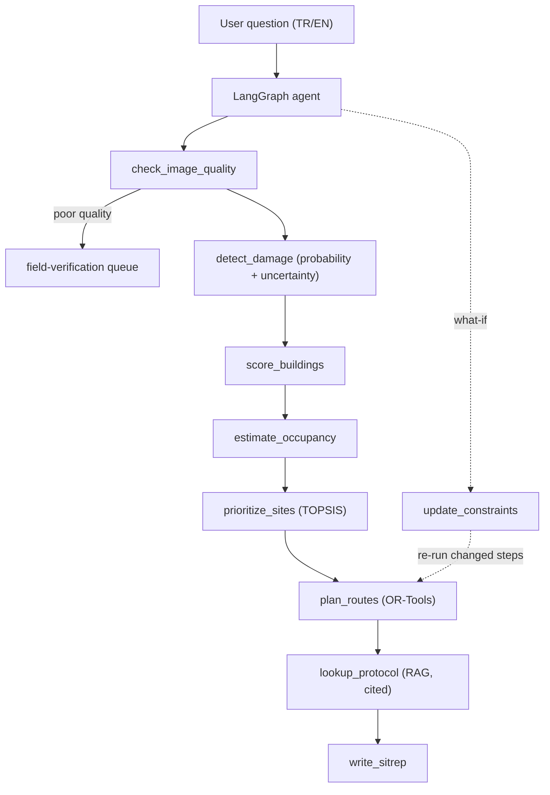

# QuakeTriage

**Agentic post-earthquake building damage assessment and rescue prioritization.**

> ⚠️ Research prototype only. Not validated for operational use in real search-and-rescue operations.

## Overview

QuakeTriage answers the question:
> "The damage map is ready. Where should I send my limited rescue teams first, and by which route? Which buildings is the model uncertain about?"

Given pre/post-earthquake satellite imagery, QuakeTriage:
1. Detects damaged buildings (change detection model with uncertainty)
2. Scores buildings by estimated occupancy and damage severity
3. Prioritizes sites using TOPSIS multi-criteria decision analysis
4. Plans optimal team routes with OR-Tools (prize-collecting VRP)
5. Grounds decisions in AFAD TAMP and INSARAG guidelines via RAG
6. Presents results through an interactive Gradio interface

## Architecture



Planned design; components are added week by week (see `PLAN.md`).

## Status

Work in progress — 8-week development plan (Nov–Dec 2026).

## Results

Generated from `reports/*.json` by `make report`; do not edit by hand.

<!-- results:begin -->
| Report | Metric | Value |
|---|---|---|
| `metrics_eda` | `train.n_samples` | 404 |
| `metrics_eda` | `train.mean_damaged_ratio` | 0.03669 |
| `metrics_eda` | `train.median_damaged_ratio` | 0.02069 |
| `metrics_eda` | `train.pct_with_any_damage` | 1 |
| `metrics_eda` | `validation.n_samples` | 44 |
| `metrics_eda` | `validation.mean_damaged_ratio` | 0.03204 |
| `metrics_eda` | `validation.median_damaged_ratio` | 0.01701 |
| `metrics_eda` | `validation.pct_with_any_damage` | 1 |
| `metrics_eda` | `test.n_samples` | 38 |
| `metrics_eda` | `test.mean_damaged_ratio` | 0.02825 |
| `metrics_eda` | `test.median_damaged_ratio` | 0.02032 |
| `metrics_eda` | `test.pct_with_any_damage` | 1 |
<!-- results:end -->

## Data Sources & Licenses

| Source | Use | License |
|--------|-----|---------|
| KATE-CD | Model training & evaluation | Citation required (Earthquake Damage Assessment with SAMCD) |
| Vantor (Maxar) Open Data | Georeferenced demo imagery | **CC BY-NC 4.0** — non-commercial only |
| HOTOSM Destroyed Buildings | Building-level validation labels | ODbL |
| OSM / HOTOSM Buildings & Roads | Building footprints, road network | ODbL |
| WorldPop Turkey 100m | Population estimation | CC BY 4.0 |
| AFAD TAMP | RAG (TR) | Public document |
| INSARAG Guidelines 2020 | RAG (EN) | Public document |

## Attribution

- **Imagery:** satellite imagery © Vantor (formerly Maxar), released under
  [CC BY-NC 4.0](https://creativecommons.org/licenses/by-nc/4.0/) through the Maxar Open Data Program.
  Non-commercial use only.
- **Map data:** © OpenStreetMap contributors and Humanitarian OpenStreetMap Team (HOTOSM), ODbL.
- **Population:** WorldPop, CC BY 4.0.
- **Training data:** KATE-CD; please cite *Earthquake Damage Assessment with SAMCD* (see `cscrs/kate-cd`).

## Documentation

See [`docs/README.md`](docs/README.md) for the documentation map: decisions, data card, model card, glossary.
Cite this repository via [`CITATION.cff`](CITATION.cff).

## Setup

```bash
# Install uv (https://docs.astral.sh/uv/)
uv sync
cp .env.example .env  # fill in your API keys
uv run pytest -q
```

## Limitations

- Population estimates are approximations (WorldPop 100m, pre-earthquake).
- Model trained on a single earthquake dataset (KATE-CD); generalization not guaranteed.
- Vantor imagery is CC BY-NC 4.0 — commercial use requires a different imagery source.
- INSARAG Guidelines 2020 used; new version effective January 2027.
