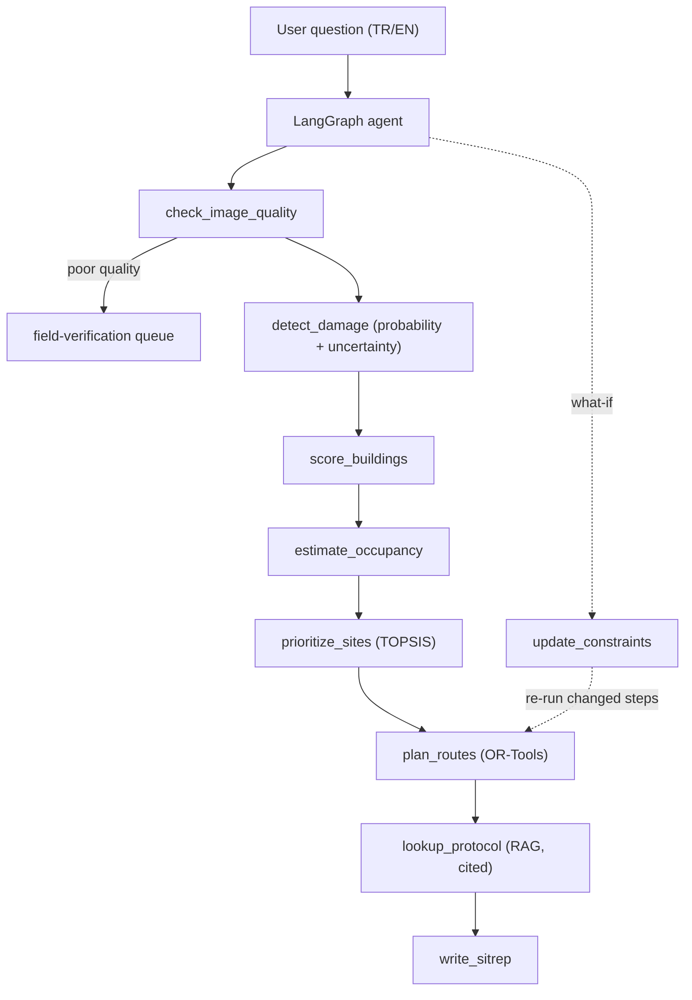

# QuakeTriage

**Agentic post-earthquake building damage assessment and rescue prioritization.**

> ⚠️ Research prototype only. Not validated for operational use in real search-and-rescue operations.

## Overview

QuakeTriage answers the question:
> "The damage map is ready. Where should I send my limited rescue teams first, and by which route? Which buildings is the model uncertain about?"

Given pre/post-earthquake satellite imagery, QuakeTriage:
1. Detects damaged buildings (change detection model with uncertainty)
2. Scores buildings by estimated occupancy and damage severity
3. Prioritizes sites using TOPSIS multi-criteria decision analysis
4. Plans optimal team routes with OR-Tools (prize-collecting VRP)
5. Grounds decisions in AFAD TAMP and INSARAG guidelines via RAG
6. Presents results through an interactive Gradio interface

## Architecture



Planned design; components are added week by week (see `PLAN.md`).

## Status

Work in progress — 8-week development plan (Nov–Dec 2026).

## Results

Generated from `reports/*.json` by `make report`; do not edit by hand.

<!-- results:begin -->
| Report | Metric | Value |
|---|---|---|
| `metrics_baseline` | `checkpoint` | baseline_best.pt |
| `metrics_baseline` | `model` | early_fusion |
| `metrics_baseline` | `split` | test |
| `metrics_baseline` | `encoder` | resnet34 |
| `metrics_baseline` | `trained_epoch` | 33 |
| `metrics_baseline` | `best_val_f1` | 0.5196 |
| `metrics_baseline` | `threshold` | 0.5 |
| `metrics_baseline` | `n_samples` | 38 |
| `metrics_baseline` | `metrics.precision` | 0.6573 |
| `metrics_baseline` | `metrics.recall` | 0.3908 |
| `metrics_baseline` | `metrics.f1` | 0.4901 |
| `metrics_baseline` | `metrics.iou` | 0.3246 |
| `metrics_baseline` | `bootstrap_ci.precision.mean` | 0.6599 |
| `metrics_baseline` | `bootstrap_ci.precision.ci95_lo` | 0.5513 |
| `metrics_baseline` | `bootstrap_ci.precision.ci95_hi` | 0.7598 |
| `metrics_baseline` | `bootstrap_ci.recall.mean` | 0.3886 |
| `metrics_baseline` | `bootstrap_ci.recall.ci95_lo` | 0.259 |
| `metrics_baseline` | `bootstrap_ci.recall.ci95_hi` | 0.5114 |
| `metrics_baseline` | `bootstrap_ci.f1.mean` | 0.4854 |
| `metrics_baseline` | `bootstrap_ci.f1.ci95_lo` | 0.3702 |
| `metrics_baseline` | `bootstrap_ci.f1.ci95_hi` | 0.5818 |
| `metrics_baseline` | `bootstrap_ci.iou.mean` | 0.3224 |
| `metrics_baseline` | `bootstrap_ci.iou.ci95_lo` | 0.2272 |
| `metrics_baseline` | `bootstrap_ci.iou.ci95_hi` | 0.4102 |
| `metrics_baseline` | `inference_secs` | 3.4 |
| `metrics_eda` | `train.n_samples` | 404 |
| `metrics_eda` | `train.mean_damaged_ratio` | 0.03669 |
| `metrics_eda` | `train.median_damaged_ratio` | 0.02069 |
| `metrics_eda` | `train.pct_with_any_damage` | 1 |
| `metrics_eda` | `validation.n_samples` | 44 |
| `metrics_eda` | `validation.mean_damaged_ratio` | 0.03204 |
| `metrics_eda` | `validation.median_damaged_ratio` | 0.01701 |
| `metrics_eda` | `validation.pct_with_any_damage` | 1 |
| `metrics_eda` | `test.n_samples` | 38 |
| `metrics_eda` | `test.mean_damaged_ratio` | 0.02825 |
| `metrics_eda` | `test.median_damaged_ratio` | 0.02032 |
| `metrics_eda` | `test.pct_with_any_damage` | 1 |
| `uncertainty_baseline_test` | `model` | early_fusion |
| `uncertainty_baseline_test` | `checkpoint` | baseline_best.pt |
| `uncertainty_baseline_test` | `split` | test |
| `uncertainty_baseline_test` | `threshold` | 0.5 |
| `uncertainty_baseline_test` | `T` | 10 |
| `uncertainty_baseline_test` | `dropout_p` | 0.1 |
| `uncertainty_baseline_test` | `n` | 38 |
| `uncertainty_baseline_test` | `results.single.f1` | 0.4901 |
| `uncertainty_baseline_test` | `results.single.ece` | 0.0186 |
| `uncertainty_baseline_test` | `results.single.brier` | 0.02124 |
| `uncertainty_baseline_test` | `results.mc_dropout.f1` | 0.487 |
| `uncertainty_baseline_test` | `results.mc_dropout.ece` | 0.01133 |
| `uncertainty_baseline_test` | `results.mc_dropout.brier` | 0.02021 |
| `uncertainty_baseline_test` | `results.mc_dropout.uncertainty_error_ratio` | 5.196 |
| `uncertainty_baseline_test` | `results.mc_dropout.mean_uncertainty` | 0.01705 |
| `uncertainty_baseline_test` | `results.tta.f1` | 0.4665 |
| `uncertainty_baseline_test` | `results.tta.ece` | 0.01309 |
| `uncertainty_baseline_test` | `results.tta.brier` | 0.01902 |
| `uncertainty_baseline_test` | `results.tta.uncertainty_error_ratio` | 20.46 |
| `uncertainty_baseline_test` | `results.tta.mean_uncertainty` | 0.01203 |
| `uncertainty_baseline_test` | `note` | MC dropout applied at inference only (checkpoint trained without dropout). |
| `uncertainty_baseline_validation` | `model` | early_fusion |
| `uncertainty_baseline_validation` | `checkpoint` | baseline_best.pt |
| `uncertainty_baseline_validation` | `split` | validation |
| `uncertainty_baseline_validation` | `threshold` | 0.5 |
| `uncertainty_baseline_validation` | `T` | 10 |
| `uncertainty_baseline_validation` | `dropout_p` | 0.1 |
| `uncertainty_baseline_validation` | `n` | 44 |
| `uncertainty_baseline_validation` | `results.single.f1` | 0.5196 |
| `uncertainty_baseline_validation` | `results.single.ece` | 0.02467 |
| `uncertainty_baseline_validation` | `results.single.brier` | 0.02702 |
| `uncertainty_baseline_validation` | `results.mc_dropout.f1` | 0.5208 |
| `uncertainty_baseline_validation` | `results.mc_dropout.ece` | 0.01629 |
| `uncertainty_baseline_validation` | `results.mc_dropout.brier` | 0.02479 |
| `uncertainty_baseline_validation` | `results.mc_dropout.uncertainty_error_ratio` | 7.161 |
| `uncertainty_baseline_validation` | `results.mc_dropout.mean_uncertainty` | 0.01983 |
| `uncertainty_baseline_validation` | `results.tta.f1` | 0.5006 |
| `uncertainty_baseline_validation` | `results.tta.ece` | 0.01593 |
| `uncertainty_baseline_validation` | `results.tta.brier` | 0.02296 |
| `uncertainty_baseline_validation` | `results.tta.uncertainty_error_ratio` | 13.88 |
| `uncertainty_baseline_validation` | `results.tta.mean_uncertainty` | 0.01941 |
| `uncertainty_baseline_validation` | `note` | MC dropout applied at inference only (checkpoint trained without dropout). |
| `vantor_stac_summary` | `event_id` | Kahramanmaras-turkey-earthquake-23 |
| `vantor_stac_summary` | `event_url` | https://maxar-opendata.s3.amazonaws.com/events/Kahramanmaras-turkey-earthquake-23/collection.json |
| `vantor_stac_summary` | `title` | Turkey and Syria Earthquake 2023 |
<!-- results:end -->

## Data Sources & Licenses

| Source | Use | License |
|--------|-----|---------|
| KATE-CD | Model training & evaluation | Citation required (Earthquake Damage Assessment with SAMCD) |
| Vantor (Maxar) Open Data | Georeferenced demo imagery | **CC BY-NC 4.0** — non-commercial only |
| HOTOSM Destroyed Buildings | Building-level validation labels | ODbL |
| OSM / HOTOSM Buildings & Roads | Building footprints, road network | ODbL |
| WorldPop Turkey 100m | Population estimation | CC BY 4.0 |
| AFAD TAMP | RAG (TR) | Public document |
| INSARAG Guidelines 2020 | RAG (EN) | Public document |

## Attribution

- **Imagery:** satellite imagery © Vantor (formerly Maxar), released under
  [CC BY-NC 4.0](https://creativecommons.org/licenses/by-nc/4.0/) through the Maxar Open Data Program.
  Non-commercial use only.
- **Map data:** © OpenStreetMap contributors and Humanitarian OpenStreetMap Team (HOTOSM), ODbL.
- **Population:** WorldPop, CC BY 4.0.
- **Training data:** KATE-CD; please cite *Earthquake Damage Assessment with SAMCD* (see `cscrs/kate-cd`).

## Documentation

See [`docs/README.md`](docs/README.md) for the documentation map: decisions, data card, model card, glossary.
Cite this repository via [`CITATION.cff`](CITATION.cff).

## Setup

```bash
# Install uv (https://docs.astral.sh/uv/)
uv sync --all-extras  # plain `uv sync` drops the torch/agent extras
cp .env.example .env  # fill in your API keys
uv run pytest -q
```

## Limitations

- Population estimates are approximations (WorldPop 100m, pre-earthquake).
- Model trained on a single earthquake dataset (KATE-CD); generalization not guaranteed.
- Model accuracy is reported on KATE-CD only. The Kilis Vantor crop is a pipeline demo (different sensors/off-nadir angles, almost no damage labels); Antakya building damage uses HOTOSM destroyed-building labels as *simulated* detector output.
- Vantor imagery is CC BY-NC 4.0 — commercial use requires a different imagery source.
- INSARAG Guidelines 2020 used; new version effective January 2027.
